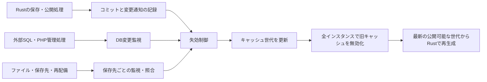

# オンメモリキャッシュと独自機能の設定画面

更新日：2026-10-30（日本時間）。D19-03はユーザーの「完全自動」で決定（R52）。製品の容量の手動上限・固定値設定は提供しない。論理予算・cache状態機械・sealed HTTP adapterは部分実装したが、完全自動容量管理、実監視との統合、管理画面は未完成。具体的な比率・監視方式・停止／復帰判定等は未決・未検証である。

## 現在の実装と製品要件の境界

coreの `PageCache`／`BudgetedPageCache` は、世代ticket、全パージ、監視喪失・照合中の保存／hit停止、LRU、明示的な論理予算を扱う。`BudgetPool` はcallerが指定する有限値と所有leaseを管理する。HTTP adapterにもlegacy／共有poolの入口があり、初期状態は容量・監視の確認がないため停止中である。これはR50の製品設定値「初期オン」を変更する決定ではなく、製品の自動allocator／monitorが未接続の開発基盤である。

開発APIと固定fixtureの手動bytes指定は、R52の管理者向け容量設定を実装したものではない。OS観測からの自動算式、同居processを含む配分、圧迫時の自動縮小・復帰、DB／fileの継続監視、複数instance失効、設定画面は未実装である。DBの有限復旧／binlog試験を、この常時監視の完成とはしない。R49～R52の要件は以下で維持する。

準備済み本文とRangeは不変のbody ownerを共有し、cache拒否時はcache leaseを持たずsealed本文を返す。保存済みcacheのleaseは保持したBody／Bytesの寿命に従う。本文以外の全allocation・RSSやCPUを予算化した仕組みではなく、purgeがtransportへ渡したbytesを撤回するものでもない。[HTTP cache](http-cache-development.ja.md)、[共有本文](shared-public-body-development.ja.md)を参照。

`inspect-memory` はhost／自身のRSS／可視cgroupを順に各1回観測する診断で、自動allocatorや監視loopではない。未知・未対応を空き容量0へ置換せず、独立した値を合算して容量算式にしない。[診断CLI](memory-diagnostic-development.ja.md)と[RSS観測](process-memory-development.ja.md)を参照。native Linuxの実観測は未完了である。

過去の開発文書にあるgate／checkpointは、その保存時点と追跡sourceに対する履歴である。最新の認証cookie検証MAIN変更後の全体再検証・source-bound証跡更新は未完了であり、過去の成功を現在tree全体の成功とは扱わない。

## 1. 決定した要件

**追加決定（2026-10-26、D07-02・R59～R61）**：DB変更検知と内部索引は[DB自動最適化仕様](database-auto-optimization.ja.md)を採用。binlog購読を標準方式の候補とし、スナップショット・ログ位置・COMMIT・公開世代を整合させる。本文の監視方式未決という記述のうちDB側の方向性は本決定で具体化し、対応版・権限・反映期限・代替方式は引き続き未決。ファイル監視の方式は別途具体化する。全パージ・監視不成立時停止を維持し、全パージだけで公開データを最新にしたとは扱わない。

| 項目 | ユーザー指定による決定 |
| --- | --- |
| 対象 | アクセスされたページ・コンテンツを稼働環境内のメモリへキャッシュする。GETクエリーを含む要求も対象 |
| 容量 | 稼働環境に適した容量を完全自動で調整する。管理者の手動上限・固定値設定は設けない（R52） |
| 初期設定 | キャッシュはデフォルトでオン。実際の利用可否は容量・監視・世代等の状態と区別 |
| 保持 | TTLによる期限切れを設けず稼働中に保持。変更時の全パージ、容量超過時の退避／削除、再起動による消失は許可 |
| 失効 | DB・ファイルへの書換えを検知して全パージする。関連ページだけの部分パージへ置き換えない |
| 監視不成立時 | 全パージして保存・ヒット利用を自動停止し、Rustの通常配信へ戻る。監視・整合確認の回復後に再開 |
| 設定画面 | WP管理画面に追加する1画面から、キャッシュを含むRecastPressの独自機能を設定可能にする |

「永続的」の意味はユーザーの確認回答で上記の保持方針に確定した。再起動後の復元を目的にキャッシュ本文をディスク・DBへ永続保存する要件は追加しない。容量超過時の削除は可能だが、無制限の保持や全アクセス結果が常に残ることは保証しない。

## 2. キャッシュ対象とキーの詳細案

まず公開可能なGET応答のページと、公開世代に由来するコンテンツ・描画結果を扱う。メモリ上のページキャッシュと内部コンテンツキャッシュを区別し、全パージ時は両方の全キー・全クエリー変種を無効化する。共有キャッシュへ管理画面、ログイン、OIDC応答・連携手続き、プレビュー、非公開データ、認証済みユーザー別の応答を格納しない案とする。個人別キャッシュの追加は採用していない。

キーはサイト／配備の識別、検証済みのホスト・パス、GETクエリー全体、必要な言語・表現の区別、公開世代・キャッシュ世代で構成する。検索・ページ送り・絞込み等で異なるクエリーの結果を混在させない。重複パラメーター、並び順、空値、エンコードの違いを、意味の同一性を証明せず統合しない。未検証のHost等によるキー汚染、巨大クエリー・無制限のキー生成も制限する。

GETであるだけで全応答を保存しない。認証情報・連携コード・秘密を含むクエリー、期限付きURL、個人別状態・Cookieに依存する応答、保存禁止等の応答は除外・再検証条件を契約化する。時刻・外部API等に依存してDB・ファイル変更だけでは更新できない出力も、無条件に無期限保存しない。[RFC 9111](https://www.rfc-editor.org/rfc/rfc9111.html)を参照し、HTTPの保存・再利用条件と内部アプリケーションキャッシュの保持方針を区別する。

TTLなしはブラウザーやCDNへ無期限のmax-ageを送る指定ではない。外部HTTPキャッシュの設定・失効・非公開化後の撤回時間は既存の公開撤回契約で別に定める。本体の全パージで、既に外部へ配信されたコピーまで削除できたとは扱わない。

後続のD21・R45により、主対象はCDNを必須としない規模の企業・紹介・カタログ・通常LP・個人等のサイトで、単一サイト月間20万PVまでを想定する。製品側の突発的な集中アクセス対策はこのオンメモリキャッシュまでとし、必要な追加対応はインフラ構成で扱う。CDNなしを基本の検証経路とし、低頻度アクセス・コールド・再起動／全パージ直後とGET変種の増加も評価する。CDNの任意導入は禁止しない。[対象サイト](target-sites.ja.md)を参照。

## 3. メモリ容量の自動設定案

OS全体の搭載量だけでなく、プロセス・コンテナ等に実際に割り当てられた制限、現在の使用量、同じ制限内にあるRust・Wasm・PHP・DB等の必要量と余裕を評価し、キャッシュ上限を算出・再調整する。本文だけでなくキー・索引・管理情報・構築中の値も計上する。複数プロセス・インスタンスのそれぞれに同じホスト全体の空き容量を割り当てる計算にしない。

Linuxのcgroup v2等は取得元の候補であり、三環境すべてで同じ値が読めると仮定しない。[Linux Kernel公式](https://docs.kernel.org/admin-guide/cgroup-v2.html)。算出不能時は有限の保守的な上限、またはキャッシュの退避・停止へ移る案とし、理由を管理画面へ表示する。具体的な算式・比率・下限・上限・再計算周期は未決。

容量超過やメモリ圧迫時は、上限内へ収まるよう使用頻度等に応じて削除する詳細案。巨大な単一値は保存を見送り、同時ミスの重複生成・メモリ増大を抑える。退避先のストレージや共有キャッシュ製品を新たな必須依存として自動採用しない。

### 3.1 容量算出に用いる情報（詳細案・未採用）

| 情報 | 取扱い案 |
| --- | --- |
| 実効メモリ上限 | プロセス・コンテナ・親の資源制限とホストの物理メモリを照合。無制限値を実容量とせず、swapをキャッシュ容量へ足さない |
| 現在の使用と変動 | 起動直後だけでなく、Rust／Wasm描画・内部処理・DB等の通常時と高水準の使用量を観測 |
| 必要な余裕 | キャッシュ外の処理、構築中の値・同時要求・アロケーターの残留等に余裕を確保。キャッシュの論理バイト数が減るだけでOS使用量も即座に減るとはしない |
| 共有する資源範囲 | 同一cgroup・ホスト等の範囲を識別し、同じ余裕を各プロセスへ二重配分しない。別ホストのDB容量はローカル予算へ加算しない |

Linuxではcgroupのmemory.currentは配下を含む使用量の参照候補、memory.max等は制限の参照候補となる。ホストのMemAvailableは利用可能量の推定であり、アプリ専用の予約量とは扱わない。[cgroup v2](https://docs.kernel.org/admin-guide/cgroup-v2.html)、[proc_meminfo](https://man7.org/linux/man-pages/man5/proc_meminfo.5.html)。実行環境による取得可否・単位・親制限・値の更新を検証してから用いる。OSの資源制限そのものをキャッシュ機能が書き換える案ではない。

算出モデルの案は、各資源範囲の有限な上限からキャッシュ外の必要量と余裕を差し引き、さらにキャッシュ用の予算・各プロセスへの割当で制限するもの。D19-03・R52により、利用者が設定する容量上限との比較は設けない。候補値が0以下ならキャッシュを退避・停止し、設定値オンは保持する。キャッシュ外の必要量は観測・予約から推定するため、単にmemory.currentから論理キャッシュ量を引けば正確に求まるとはしない。算式・比率・観測期間・最低限の余裕は未確定。

### 3.2 起動・圧迫・回復時の制御（詳細案）

起動時は環境と世代・監視状態を確認してから、有限の容量で利用を始める。メモリ圧迫や制限縮小を検知した場合は、新規保存と生成用の予約を抑え、既存エントリーを減らす。下限容量を守るために通常処理を圧迫する設計にはしない。必要なら実利用を止め、Rustの通常配信へ戻る。

余裕が一定期間継続して観測できたら段階的に容量を増やす。小さな変動で拡大・縮小を繰り返さない判定を設け、周期・閾値・増減幅は測定して決める。複数の公開プロセス等が同じ資源範囲を共有するときは、合計予算と配分を整合させる。別の常駐製品をこの調整のためだけに必須採用しない。

キー・本文・索引・管理情報・生成中の予約を上限へ計上し、保存前に容量を確認する。単一の巨大な応答や無数のGET変種で予算を超えないようにし、退避アルゴリズム・単一値上限・生成の同時数は詳細化する。TTLによる期限切れを追加する制御にはしない。

上限や使用量を信頼して取得できない場合は、無制限の利用をせず、情報不足として理由を表示する。有限の保守値で利用できる条件や停止条件は、環境ごとに検証して契約化する。取得不能を利用可能量0と同一視したり、安全な値を算出できたと表示したりしない。追加1画面には設定オン／実稼働状態、自動算出値、現在使用量、制限理由と取得元を表示する案とする。

### 3.3 容量は完全自動（D19-03、決定）

**決定（2026-10-25）**：ユーザーが「完全自動」と回答し、Bを採用（R52）。管理者が指定する最大容量・固定容量の設定は設けない。移行アシスタントにも、移行後の追加1画面にも容量の入力欄を設けない。

容量は環境・使用量から自動調整する。使用量・自動算出値・制限理由を表示する詳細案とし、キャッシュの利用オン／オフは別設定として維持する。具体的な算式・比率・観測周期・縮小／復帰条件を確定した回答とは扱わない。

比較履歴：Aは自動調整に任意の手動上限を加える案、Bは完全自動で手動上限を設けない案。Aは採用しない。

## 4. 変更検知と全パージの詳細案

監視対象はサイトのDB・コンテンツ／メディア・テーマ／Wasm・資産・設定等の書換えを含めて台帳化する。どのデータを監視するかを明示し、Rust経由の変更だけを見て外部SQL・外部ファイル変更も検知済みとしない。キャッシュ自身の管理情報やアクセスログ等を監視へ含めると無限にパージし得るため、その扱いと監視範囲を明示して契約化する。未監視対象を黙って除外しない。

| 変更元 | 検知方式の候補・検証事項 |
| --- | --- |
| RustによるDB・設定・公開世代の変更 | コミットと失効世代の記録を一貫させる。部分失敗・再送でも全パージの通知を失わない |
| PHP管理処理・外部SQLによる変更 | DB変更ログ・CDC等の候補を、MariaDB／MySQLの採用版・権限・マネージド制約に合わせて検証。フックだけに依存しない |
| ホスト上のファイル変更 | ファイル監視と再照合。上書き・rename・置換・削除・監視イベント欠落を扱う |
| オブジェクト保存・イメージ再配備 | 保存先の通知・世代／内容ハッシュ等で検知。全構成に同じファイル監視があると仮定しない |

MySQL／MariaDBのbinlogは変更イベントの参照候補。[MySQL公式](https://dev.mysql.com/doc/refman/8.4/en/binary-log.html)、[MariaDB公式](https://mariadb.com/docs/server/server-management/server-monitoring-logs/binary-log)。候補を挙げただけで、両DB・三環境の外部変更を漏れなく即時検知できるとしない。ログの設定・権限・保持・再接続の確認が必要であり、常に同じ設定で利用できるとは仮定しない。ファイル監視もイベント欠落を考慮する。[inotify公式マニュアル](https://man7.org/linux/man-pages/man7/inotify.7.html)。D19-01で監視不成立時はキャッシュ停止を採用。定期照合は整合確認・回復の補完候補に残すが、監視不成立のままキャッシュを継続する根拠にはしない。最大遅延・監視方式・具体的な停止／復帰判定は未確定。

変更検知時は配備内で共有する失効世代を更新し、全インスタンス・全種類・全GET変種の旧キャッシュを再利用不能にする。物理削除が非同期でも、旧世代を返さないことを先に保証する。生成中・再投入中の処理も世代を照合し、パージ前の結果をパージ後へ登録・配信しない。通知欠落・インスタンス再接続・世代確認不能も試験する。具体的な共有・配信方式と権限は未決。

パージは元データから新しい公開世代を生成する処理の代わりではない。DB・ファイル変更後の公開反映・非公開化と連携し、旧世代しかない状態で古い内容をキャッシュミス後に再登録しない。最新版が公開可能になるまでの待機・応答条件を定め、公開GET起点でPHPを動かして穴埋めしない。キャッシュは失われても原本データを失わない派生情報として扱う。

### 4.1 変更から再配信までの流れ（詳細案・未採用）

1. 管理・内部のDB変更は、実データのコミットと変更通知の記録を一貫させる。更新完了の応答時点と、失効世代が確定する時点を契約化する。外部SQL等は別の監視経路で補う。
2. ファイル・オブジェクト保存・再配備では、保存先の世代・マニフェスト等を追跡する。製品管理下の置換は書換え前後の失効と完了を調整する。外部操作は検知遅延を別に記録する。
3. 対象の変更を検知したら全キャッシュの世代を更新する。変更箇所だけのパージにはしない。通知の重複は許容するが、古い通知の再送で現在の世代を元へ戻さない。
4. 読取り・生成中の要求は、使用する公開世代とキャッシュ世代を保持し、登録・配信前に有効性を確認する。全パージをまたいだ古い生成結果は再登録・再配信しない。すでに送信済みの応答を回収できるとは扱わない。
5. 旧エントリーを物理削除してメモリを回収する。論理失効だけで無制限に旧データを残さない。再生成要求は既決の公開読取り権限だけで処理し、PHP・汎用管理ジョブを起動しない。

キャッシュ制御用メタデータと失効世代の保存先・通知方式は未選定。全GETで編集DBへ問い合わせる方式や、Redis等の追加サービスをこの案だけで必須化しない。通知だけでは全インスタンスの受領を証明できないため、起動・再接続時の世代照合、欠落検知、確認できないインスタンスのキャッシュ利用抑止を設計する。世代番号の再利用やバックアップ復元・再配備をまたぐ旧データの再露出も検証する。

### 4.2 監視状態と回復（詳細案）

監視対象ごとに「初期照合中」「追跡中」「再接続／再照合中」「利用不可」を記録する。DBログが保持範囲から失われた、ファイル監視があふれた、保存先の通知に欠落がある、資格情報が失効した等の状態を管理画面へ表示する。単に監視プロセスが生存していることを追跡成功とみなさない。

権限不足等で監視できない構成でも、直接書換えを未検知のまま対応済みとはしない。再照合で整合を確定し、全パージと現在の公開世代の確認が済んでから通常のキャッシュ利用へ復帰する。定期照合の候補も、件数や最終更新日時の比較だけで全更新・削除・置換を網羅できると仮定しない。監視と照合の対象、コスト、遅延の上限、復帰基準を採用版・保存先で検証する。

### 4.3 監視不成立時のキャッシュ動作（D19-01、停止・通常配信で決定）

**決定（2026-10-25）**：ユーザーがAを選択。変更監視の追跡を確認できない間は全パージし、保存・ヒット利用を自動停止してRustの通常配信へ戻る（R49）。監視・整合確認の回復後に再開。以下は比較履歴。

| 選択肢 | 変更通知の追跡を確認できない場合 |
| --- | --- |
| A：キャッシュを自動停止して通常配信（推奨案） | キャッシュを全パージし、保存・ヒット利用を停止。現在の公開可能なデータをRustで通常配信し、監視・照合の回復後に再開。監視を用意できない配備ではキャッシュを利用できない |
| B：定期照合でキャッシュ利用を継続 | 原本を照合できる場合は、照合のたびに差分を検知して全パージし、それまではキャッシュを利用。更新反映に照合間隔と処理時間分の遅延を許容し、原本の照合自体も不可能なら利用停止 |

停止中は古い値を使わず、新しい結果もキャッシュへ保存しない。監視を用意できない配備では利用不可として理由を追加1画面へ表示する。通常配信にも公開起点のPHP禁止を適用し、原本／公開世代の整合性まで不明なら、通常配信を最新保証とはせず既存の公開反映・待機／応答契約に従う。

復帰の詳細案は、監視の接続・権限・追跡を確認→欠落した変更と原本／公開世代を再照合→失効世代を更新して再全パージ→空のキャッシュで再開とする。単に監視プロセスが再起動しただけで復帰させない。通知欠落・世代確認不能のインスタンスも、整合を確認するまで再利用を許さない。具体的な監視・照合間隔、障害検知時間、復帰の合格条件・管理操作の扱いは未確定。

### 4.4 キャッシュの初期有効化（D19-02、デフォルトオンで決定）

**決定（2026-10-25）**：ユーザーが「デフォルトでオン」と指定。R50へ反映。以下は比較履歴であり、現在の初期設定はオンとする。

| 選択肢 | 新規導入時の動作 |
| --- | --- |
| A：利用条件を満たせば自動で有効（推奨案） | 容量算出・変更監視・失効世代の確認等を通過した環境で自動有効化。不成立なら通常配信と理由表示 |
| B：初期オフ、管理者が有効化 | 条件を満たしていても、追加1画面で管理者がオンにするまで使わない。有効化時にも同じ検査を行う |

設定値のオンと、実際の稼働状態を分ける。初期化・容量算出・監視／世代の確認中は通常配信し、監視不成立時は設定値を勝手にオフへ書き換えず、R49により実際の保存・ヒット利用を止める詳細案とする。管理画面では「設定オン／停止中」と理由を表示する。条件を確認できたら有効にし、停止後の再開は4.3の整合確認と全パージを経る。検査の具体条件・容量上限等は未確定。キャッシュのオンをSSOや自動更新の初期設定へ転用しない。

## 5. 独自機能の追加1画面（D20）

RecastPress側のWP準拠管理画面へ、独自機能用の設定画面を1つ追加する。標準の投稿・編集・分類等の画面は基準WPに沿い、独自機能の設定を別々の追加画面へ分散しない。これは元WPホストで動くPHP移行プラグインのウィザードとは別の設計。元PHP版WPコアを本番へ戻す理由にしない。

1画面内のセクション・タブ等で、キャッシュ、SSO、更新支援、その他の独自設定をまとめる詳細案。キャッシュの使用量・自動算出上限・退避数・最終パージ・変更監視状態・手動全パージ等の状態と操作も同じ画面へ収める。メニュー名・配置・実際の項目構成は未確定。OIDC連携の本人向け手続きは共通のサイト設定とは別の認証フローとして扱う。

**決定（D16-02・R51、2026-10-25）**：ユーザー指定により、独自機能の初期設定は移行アシスタント内で質問する。キャッシュの初期オン、SSOの初期オフ等の既決値を表示し、選択結果を移行計画へ保存する。移行後の追加1画面は維持し、同じ設定を変更可能にする。[移行アシスタントの設定工程](wp-migration-plugin.ja.md)を参照。画面ごとに別の設定定義・既定値を作らない。

管理画面と設定APIはRustで実装し、設定変更・全パージを操作ごとに認可・CSRF検査・監査する詳細案。一般ユーザーやOIDC連携専用セッションへサイト全体の設定・パージ権限を渡さない。RecastPress本体の自動更新は専用実行担当へ権限を分離する案とし、Web画面へホスト管理権限を持たせない。OS・DB等は操作説明・セットアップ支援であり、更新実行コードを追加しない。配信終了版への強い警告も同じ追加1画面へ収める詳細案（R56）。Gutenberg等の実装コード再利用の判断まで、この1画面の要件だけで確定しない。

## 6. 検証計画と残件

T35でクエリー変種・個人別応答の除外、TTLなし、容量の自動算出・圧迫・再起動、DB・ファイル変更の全パージを検証する。外部SQL、ファイル置換、複数インスタンス、通知欠落、生成中のパージ、旧世代の再登録・非公開情報の再露出も含める。容量算式、退避方式、監視範囲・方式・遅延、キー・除外・時刻／外部依存、HTTPキャッシュ連携の契約は未完了。

T36で独自機能を追加1画面から設定でき、認可・CSRF・直接API要求・OIDC連携用セッションの拒否、設定保存・状態表示・手動パージが整合することを確認する。これら製品全体の三環境・負荷・失効・画面試験は未実施であり、既存の有限なcache契約試験とは区別する。

T35へ、監視の初期照合・切断・欠落・ログ保持切れ・イベントあふれ、通知の重複・順序逆転、全パージ中の生成と物理回収、インスタンス起動・再接続、復元時の世代再利用、停止／照合中の通常配信と公開反映の扱いを追加する。R49により監視不成立を検知した後は、全パージして保存・ヒットを止める期待結果とする。

T40で停止中の通常配信・公開反映・PHP非到達、未回復時の再利用拒否、整合確認・再全パージ後に空のキャッシュから再開することを検証する。具体的な停止・復帰判定を契約化してから試験を行う計画で、未実施。

T41で初期設定オン、条件確認中／監視不成立時の実稼働停止、管理者が選んだ設定値の保持を検証する。T42で移行アシスタントの回答と移行後の追加1画面の保存値・実稼働表示が一致することを確認する。未実施。

容量のT35へ、親子のメモリ制限、無制限表示、共有予算、値の取得不能、通常処理の使用増加、生成中の予約、巨大応答・GET変種、制限の動的縮小・回復時の段階的拡大を追加する。R52により移行・管理UIと設定API・CLI等に手動容量設定がなく、容量入力なしで初期化・再開・環境変化への自動調整が行われることをT35・T36・T42へ対応付ける。具体的な値・周期と性能への影響は未測定。
