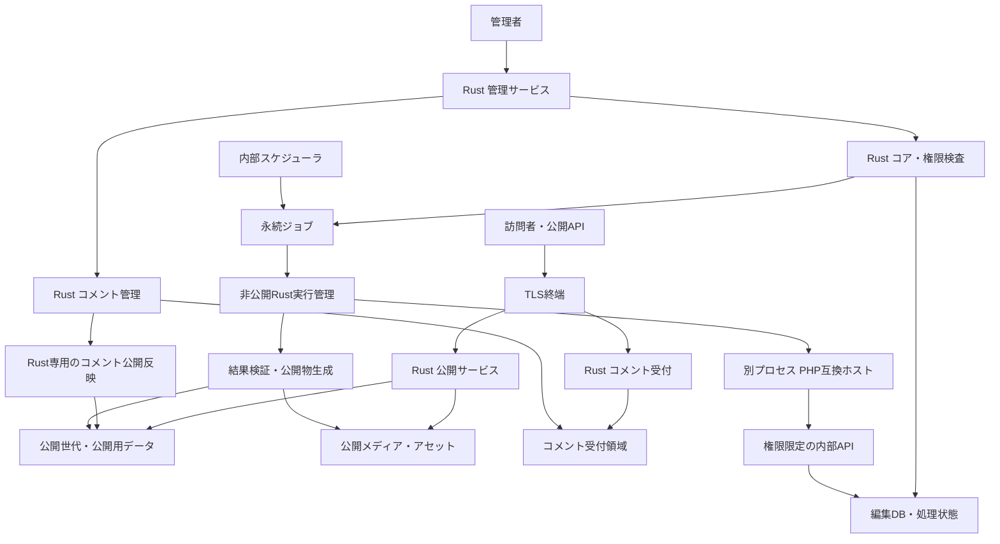

# RecastPress 詳細設計書

実装の到達点：sealed HTTP／bundle V3資産・package、process内同世代page選択、独立Wasm consumer、WP固定DDL・raw DB／CAS・所有binlog fixture、WP部分互換・認証部品がある。認証付き管理UI／標準保存・永続job／ライブ公開・製品Wasm SDK／OIDC・三環境native配備・自動容量管理・本体更新は完成していない。process内revisionや固定A/B試験を、第6.2節の永続公開・第11章の運用達成と同一視しない。

> 実装照合（2026-10-30）：基盤・有限試作を実装済み。直近Cookie照合は本体取り込みと対象検証までで中断し、採用後の全体検証は未実行。[実装と上位設計の照合](implementation-design-reconciliation-2026-10-30.ja.md)と[開発メモ](development.ja.md)を参照。設計案・未決事項を採用済みとは扱わない。

版：0.45／設計協議中・実装状況整合化（採用要求の追加変更なし）  
更新日：2026-10-30（日本時間）  
対象：製品要件、アーキテクチャ、互換性、移行、運用、検証。部分実装と製品要求の達成を区別する。確定要求R01〜R61、試験計画T01〜T44。

## 1. 文書の読み方

再開時は [引継ぎ・再開ガイド](handoff.ja.md) を先に参照する。キャッシュ容量は完全自動（R52）。D27・D27-01で更新方針を確定。RecastPress本体は自動更新し、その他は操作説明・セットアップ支援のみで更新実行コードを持たない。セキュリティ更新が自動配信される版をサポート対象とし、配信終了版には強く警告する（R40・R56）。本体更新の細部は未決で、旧D18-01のA/Bは現行の質問として使わない。D27-02・R57で、スキーマ変更のない本体更新はRust本体全体を一時的に二重起動して切り替える方式を採用。無停止は保証しない。検証計画は維持し、スキーマ変更がある更新の方式は未決。本体自動更新機能の実装・切替試験は未実施。

**決定**はユーザーが採用した内容、**提案**は具体化のための設計案、**未決**は回答が必要な論点を示す。第2章以外の詳細仕様は、個別に決定と書かない限り提案であり、承認済みと扱わない。未決事項と選択肢は [decisions.ja.md](decisions.ja.md)、出典・会話の突合結果は [sources.ja.md](sources.ja.md) に記録する。

本書だけを根拠に設計案を承認済みとは扱わない。別途の継続開発指示で基盤を実装したが、2026-10-30のユーザー指示で製品コード開発は中断。今回の文書整合化は開発再開・配備の指示ではない。

前回終了時の文書整理は[整合確認記録](design-closeout-2026-10-25.ja.md)を参照。未決一覧は20分類（保留1）。D07-01で[編集用DBのWP互換構造維持](database-schema.ja.md)を採用（R58）。次はD08-01の[プラグイン直接SQLの許可方針](plugin-database-access.ja.md)を提案中・未採用。

## 2. 決定事項と製品の目的

| ID | 決定した要求 | 根拠 |
| --- | --- | --- |
| R01 | 名称はRecastPress | 名前候補を考える |
| R02 | WordPressコアをPHPからRustへ移植し、フォーク・移植元を明記してOSS公開する | WPのRust移植 |
| R03 | 本体・独自互換レイヤーはGPL-2.0-or-laterを基本とし、GPLv2で配布できる依存構成を維持してGPLv2-onlyプラグインへの対応余地を残す | 元会話＋本チャットの追加決定 |
| R04 | Rustを唯一の本番CMSコアとし、PHP版WordPressコアは本番に残さない | WPのRust移植 |
| R05 | 既存PHPランタイムを別プロセスで使い、独自のWordPress互換APIを実装する | WPのRust移植 |
| R06 | 公開閲覧・公開APIから、直接・間接・非同期を問わずPHPを起動しない | WPのRust移植／移行先プラットフォーム設計 |
| R07 | PHPプラグインは認証・認可済み管理処理と内部ジョブで利用する。訪問者に直接対応するPHPプラグインは使わない | WPのRust移植 |
| R08 | 既存HTTPライブラリを用いてRustにWebサーバーを内蔵する | WPのRust移植 |
| R09 | CMS、標準稼働環境、移行ツール、運用ツールをパッケージとして設計する | 移行先プラットフォーム設計 |
| R10 | 既存PHPテーマとfunctions.phpを利用者が自身の契約したAIでRustへ移植する前提とし、その移植成果物の受入れを初回リリースに含める。任意テーマの移植を目標とする | 本チャットの最新指示により変換主体を更新 |
| R11 | Dockerイメージを配布基準とし、Linux Docker Composeを標準実行形として初回から正式対応する。Linux systemdで直接実行できる基本構造は保つが公式対応から外す | D26のユーザー指定 |
| R12 | RailwayとAWS Lightsailを初回の正式対応対象とする。RailwayはDockerイメージをサービスへ配置し、LightsailはLinuxインスタンス上のDocker Composeで配置する。RenderとCloud Runは初回対象から外す | D25・D26のユーザー指定 |
| R13 | AWS App Runnerを対象から外す。AWSの初回対象はLightsailとする | 本チャット |
| R14 | RecastPressの移植支援・成果物検証はAI接続なしで利用できる。利用者が自身のAIへコードを渡して変換する作業はシステム外で行う | 本チャットの最新指示によりローカル完結の境界を明確化 |
| R15 | 公式テンプレートタグを含むWPコア標準のテーマ用API全体を互換対象とする。条件分岐・クエリ・ループ・フック・設定・翻訳・エスケープ等を含む。基準版はR19 | 本チャットで①を選択 |
| R16 | MariaDBとMySQLを初回から正式対応対象にする。編集用スキーマはR58。対応版・設定・直接SQLの扱いは別途決める | D07の推奨案を選択、D07-01でスキーマ方針を決定 |
| R17 | AIの選択・契約・操作・コード変換は利用者が担う。RecastPressはAI API接続、APIキー管理、課金、モデル実行を製品の移植経路に含めず、Rust API・移植資料・検証・配備を提供する | 本チャットで役割分担を明示 |
| R18 | 移植RustコードをWasmへビルドし、RecastPressのサーバー上で実行する方式を初回の標準とする。具体的エンジン・版・プロセス配置は別途決める | 本チャットで実行方式の推奨案を選択 |
| R19 | WordPress 7.1.3を互換基準に固定し、その版に残る非推奨の標準テーマ用APIも対象とする | 本チャットで基準版・非推奨APIの方針を承認 |
| R20 | 初回の正式対応は単一サイトを先行する。WordPress互換のマルチサイトは後続対応とする | レビュー後の第1件でA案を選択 |
| R21 | 単一サイト内検索をRustで処理する機能を初回に含め、結果・ページ送り・0件表示まで検証する。方式・対象・並び順の詳細は別途決める | レビュー後の第2件でA案を選択 |
| R22 | 既存WordPressホストへ導入するPHP製の対話型マイグレーションプラグインを用意する | ユーザーの追加アイデアと作成方針の指示 |
| R23 | 移行プラグインは認証付き直接転送と、ファイル書出し・移行先への取込みの両方を提供する | D16-01でA案を選択 |
| R24 | RSS・Atomの記事更新フィードをRustで配信する機能を初回に含める。コメントフィードは後続のR32で採用、標準の配信詳細はR31に沿って照合する | D10-02でA案を選択、D10-09・10で更新 |
| R25 | 既存コメントの移行と公開済みコメントのRust表示を初回に含める。非公開状態・個人情報の取扱いと表示詳細は別途契約化。新規受付はR26 | D10-03でA案を選択 |
| R26 | 新規コメント・返信をRustで受け付ける機能を初回に含める。PHPを経由させず、設定方針はR27、個別契約・追加スパム対策等は別途具体化する | D10-04でA案を選択 |
| R27 | コメントの受付・承認設定はWP仕様を踏襲し、RecastPressの初期設定では新規コメントを受け付けない。既存コメントの表示と受付の有効化を区別する | D10-05でユーザーが仕様を指定 |
| R28 | 移行元WPのサイト・投稿ごとのコメント受付状態と承認設定を引き継ぐ。新規サイトの初期値offで既存設定を上書きしない | D10-06でA案を選択 |
| R29 | WP標準相当の管理者・記事著者向けコメントメール通知をRustで初回提供する。送信基盤・初期送信設定は別途決め、一般投稿者向け返信購読は含めない | D10-07でA案を選択 |
| R30 | 初回のコメントの重複・連投・承認待ち・不許可等の設定と判定は、基準WP本体の仕様に準拠しRustで提供する。独自の追加制限や外部サービスは一括採用しない | D10-08でユーザーがWP本体準拠を指定 |
| R31 | WP本体のコア標準機能・設定・APIの振る舞いを基本仕様として統一。既決の差分を維持し、標準機能の採否を再質問せず固定7.1.3ソースから契約・試験へ起こす | D10-10でユーザーが一貫したWP標準準拠を指定 |
| R32 | WP準拠のサイト全体・記事ごとのRSS 2.0・Atomコメント更新フィードをRustで初回提供する | D10-09への回答「WP本体の標準仕様で一貫して」 |
| R33 | 公開系と管理系のRustサービスを別プロセスに分離する。公開読取りに管理DB資格情報・PHP起動能力を渡さない。具体的なホスト・コンテナ・内部通信配置は詳細化する | D05でA案を選択 |
| R34 | 管理画面・管理操作用APIはインターネットからHTTPSで利用可能とし、認証・認可で保護する。VPNによる追加制限は任意。認証の具体化はR35〜R37に従う | D06-01でA案を選択、後続の認証方針を反映 |
| R35 | 全ユーザー向けのSSOを初回の標準機能として提供する。初期状態はoff。SSOの提供・有効化とMFAの強制を区別する | D06-03でユーザーがSSO標準・初期offを指定 |
| R36 | RecastPressにMFA機能を実装しない。登録・要素検証・強制・MFA管理／回復を製品要件にしない。外部IdP自身の認証方針とは区別する | D06-02に対するユーザーの「MFAは実装しない」 |
| R37 | SSOの対応方式はOIDCのみ。SAMLの初回実装・後続対応予定を採用しない | D06-04に対するユーザーの「SSOはOIDCのみ」 |
| R38 | SSO方針をオフ／ユーザーが任意に導入可能／必須要求の3段階とする。初期値はオフ | D06-05でユーザーが3段階を指定 |
| R39 | SSO必須要求時は、既存ユーザーのパスワードログインを各ユーザーにつき一度だけ許可する。利用範囲は後続のR41で連携手続きに限定。消費時点・再開／回復等は別途具体化 | D06-06でユーザーが一度限りの許可を指定、D06-07で範囲決定 |
| R40 | RecastPress本体に一般的な自動更新機能を提供する。本体以外のOS・Docker・DB・PHP等は操作説明・セットアップ支援に限定し、更新を実行するコードは持たない。本体更新の条件・権限・復旧は具体化する | D27と本スレッドでのユーザー指定 |
| R41 | SSO必須時の既存ユーザーの一度限りのパスワードログインは、OIDC連携手続きだけに限定する。OIDC本人確認・連携完了前に通常機能を許可しない | D06-07でA案を採用 |
| R42 | アクセスされたページ・コンテンツをGETクエリーも含めオンメモリでキャッシュし、稼働環境に応じ容量を自動設定。TTLで期限切れにせず、DB・ファイル書換え検知時は全パージ。容量超過・再起動での消失は許可 | D19の追加指定と保持に関するユーザーの確認回答 |
| R43 | RecastPressの独自機能は、WP管理画面へ追加する1画面から設定可能にする | D20でユーザーが追加1画面を指定 |
| R44 | 一度のパスワード認証によるOIDC連携専用セッションが有効な期限内は、連携手続きを再開可能とする。失効・紛失後は別途定める回復へ進む | D06-08でA案を採用 |
| R45 | CDNを必須としない、大企業ではないカンパニーサイト・商品紹介・カタログ・ブランディング・大規模キャンペーンを打たないLP・アマチュアサイトを主対象とし、単一サイトあたり月間20万PVまでを想定する。製品側の突発的な集中アクセス対策はR42のオンメモリキャッシュまでとする | D21のユーザー想定と規模の指定 |
| R46 | 利用者または委託先が自身のAIでテーマ・functions.phpを移植できるよう、診断結果に基づく具体的なプロンプトと段階別手順を提供する | D22のユーザー指定 |
| R47 | 問い合わせフォームをCMS本体から切り離し、WordPress内への統合を非推奨とする。移行診断で既存フォームを検出し、Tallyを第一推奨、独自デザイン向けにWeb3Formsを代替候補として、リンク・埋込み・外部送信への置換を案内する。本体は受付の中継・フォーム用SMTP・配送・問い合わせデータ保管を持たない | D23・D23-01のユーザー指定 |
| R48 | 個別サポートや制作者による受託を前提としないOSSパッケージとして提供する。AIコーディングによる実装量の多さ自体は対応先削減の理由にせず、必要性と実装・検証・保守の負荷を個別に評価する | D24のユーザー指定 |
| R49 | 変更監視の追跡を確認できない間は全パージし、キャッシュの保存・ヒット利用を自動停止してRustの通常配信へ戻る。監視・整合確認の回復後に再開する | D19-01でA案を選択 |
| R50 | オンメモリキャッシュの設定値はデフォルトでオンにする。監視不成立等による実稼働停止はR49に従い、設定値と区別する | D19-02に対するユーザーの「デフォルトでオン」 |
| R51 | 独自機能の初期設定は移行アシスタント内で利用者へ質問する。移行後はWP管理画面の追加1画面から同じ設定を変更可能にする | D16-02のユーザー指定 |
| R52 | キャッシュ容量は完全自動で調整し、管理者が指定する最大容量・固定容量の設定は設けない。移行アシスタントと移行後の追加1画面に容量の入力欄を設けない | D19-03に対するユーザーの「完全自動」 |
| R53 | テーマ・functions.phpの移植、テスト結果の確認、公開判断は利用者または委託先が担う。RecastPressの支援機能は移行成功を保証しない | D28のユーザー指定 |
| R54 | 移行診断で製品方針、作業範囲、未確認・非対応を明示し、移植用とテスト用のプロンプトを提供する。元WPの代表ページの画面・HTTP応答を初回診断時と最終同期後の切替直前に記録し、比較の基準とする | D28のユーザー指定 |
| R55 | コメント受付と通知はWP標準機能の移行用に提供し、通常利用の推奨とはしない。新規サイトのコメント受付初期offを維持し、外部メールサーバーへの接続・配信成功は保証しない | D29のユーザー指定 |
| R56 | セキュリティアップデートが自動配信される範囲の版をサポート対象とし、配信終了版を強く警告する。RecastPress本体と外部環境の各対象について配信継続状態を区別する | D27-01のユーザー指定 |
| R57 | スキーマ変更がないRecastPress本体更新は、Rust本体全体を一時的に新旧二重起動して切り替える。無停止は保証しない。スキーマ変更を伴う更新方式は別途決定する | D27-02の採用指定と「実証しない」から「保証しない」への訂正 |
| R58 | 編集用の正本はWPコアのテーブル・列・値の意味を互換維持し、RecastPress独自状態と検証済み公開用データは別領域へ保持する。直接SQLの許可・物理配置は別途決める | D07-01でA案を採用 |
| R59 | WP互換DBを正本に維持し、Rustコア内部の再構築可能な検索用データ・オンメモリ索引で自動高速化する。性能設定チューニング・全テーブル常駐・外部検索サービスを必須にせず、結果同等性を保証できない条件は通常処理へ戻す | D07-02の仕様案を承認 |
| R60 | binlog購読を標準変更検知方式の候補として採用。整合スナップショットとログ位置を対応させ、外部更新をCOMMIT単位で追跡する。監視用設定・権限は配備要件として具体化し、初期方式ではトリガーを自動設置しない | D07-02の仕様案を承認 |
| R61 | 内部データ・索引・公開世代を整合させ、追跡不能時は全パージ・キャッシュ停止、ログ消失時は再構築する。公開系へ編集DB資格情報を渡さず、外部更新の反映遅延と公開撤回期限を別途契約化する | D07-02の仕様案を承認 |

R10は製品目標であり、任意のPHPコードを完全移植できると検証済みの意味ではない。以前の内蔵自動変換を前提とした案を、利用者AIによる移植と成果物受入れへ更新した。任意テーマへの挑戦を維持しつつ、初回リリースの達成判定はD04で協議する。

「単一実行ファイル」はRust HTTPサービスの配布単位を意味し、DBやPHPランタイムまで一ファイルに収納する要求ではない。D05により公開系と管理系は別プロセスとする。同じ実行ファイルを役割別に起動する方式は候補であり、別ホスト・別バイナリ・別コンテナまで必須とした決定ではない。

英語の説明文案（新規案・未承認）：

> RecastPress is an open-source Rust port of the WordPress core with an integrated web server. It provides APIs and validation tools for users to port existing themes to Rust with their own AI tools, and supports PHP plugins for administrative and background processing while keeping PHP execution out of public request handling.

## 3. 初回機能の範囲

| 分野 | 初回仕様案 | 未決事項 |
| --- | --- | --- |
| コンテンツ | 投稿・固定ページ、下書き、改訂、公開・非公開、予約公開、カテゴリ・タグ、メタデータ。コメント機能と管理者・記事著者向け通知をRustで初回対応。受付・承認設定はWP準拠、新規サイト初期受付は無効、移行元設定は引継ぎ | 標準の投稿型・分類管理とコメントAPI・判定のソース照合、管理UIの実現方式、通知基盤等。標準機能の採否は再質問しない |
| メディア | 元ファイル、派生画像、説明・代替テキスト、添付関係、URL対応表 | 画像処理方式、容量・ファイル種別上限 |
| 編集 | 投稿編集、メディア管理、公開状態・失敗理由の表示。独自機能の設定はWP管理画面の追加1画面へ集約 | 標準管理画面の実現コード・Gutenberg再利用、追加1画面内の項目・配置 |
| テーマ | 利用者AIで移植するRustテーマ・functions.php由来拡張の受入れ、Wasmビルド・サーバー実行、移植診断、具体的なプロンプト・手順、資産移行、比較検証 | SDK・エンジン・合格基準、手順の実行可能性 |
| プラグイン | 管理・保存・公開・内部ジョブ用の互換実行 | 具体的な製品・版、管理画面互換、直接SQL |
| 公開配信 | URL解決、ページ描画、静的配信、404、リダイレクト、SEOメタ情報、Rust検索、記事／コメントフィード。R42のオンメモリキャッシュ。コア標準REST等も採用対象 | コア仕様照合、容量自動調整、全パージ・外部変更検知・公開世代との整合性 |
| 移行 | 診断、取得、移植支援、インポート、プレビュー、最終同期、切替計画、復旧。元WPのPHP製対話型プラグインと両転送方式を用意。問い合わせフォームの分離方針と移行後の非互換を診断で表示 | プラグインの配布・対応リリース・最低版、転送プロトコル・形式、停止・規模・ユーザー移行、仲介サービスの要否 |
| 運用 | 初期設定、更新、バックアップ、復旧、ステージング、ヘルスチェック。RecastPress本体の自動更新と環境更新の手順を提供 | 保存先・保存期間、RPO/RTO、CLI名、本体自動更新の対象版・既定値・時間帯・再起動・権限・復旧 |

**決定（R20、2026-10-25）**：初回は単一サイトの導入・移行・運用を正式対応対象とし、WordPress互換のマルチサイトは後続対応にする。複数の独立した設置とマルチサイトを区別する。マルチサイト元を単一サイトへ変換して移行する機能も、この回答では採用していない。

標準テーマ用API全体というR15の製品目標は保持する。初回は単一サイトでの動作契約を合格対象とし、ネットワーク固有機能の未提供・未検証を明示する。単一サイトでも意味を持つAPIや、マルチサイトか否かを判定するAPIを一律に除外しない。マルチサイト条件下まで全対応・検証済みとは表示しない。

**決定（R21、2026-10-25）**：サイト内検索をRustで処理し、初回の公開機能に含める。検索フォーム・受信処理・結果・ページ送り・0件表示を合わせて検証し、非公開データを検索結果へ露出させない。標準の対象・並び順等はR31により基準WPを照合する。内部の実装方式、独自の検索拡張等は別途具体化する。

**決定（R24、2026-10-25）**：RSS・Atomの記事更新フィードをRustで初回対応する。標準テーマからのリンク、既存購読URLと配信結果、公開データとの世代整合性を検証する。コメントフィードはR32で追加採用。分類・著者等の種別、全文／要約、件数、旧形式等のコア標準仕様はR31で照合する。キャッシュ実装・独自フィードは別途具体化する。

詳細案では、下書き・非公開記事や非公開本文・抜粋を含めず、非公開化・削除をフィードとキャッシュへ反映する。XML・HTMLの出力位置に応じて整形・エスケープし、本文の標準フィルターと移植Wasmの契約を比較する。フィード要求をPHP・管理ジョブの起動に結び付けない。

**決定（R25、2026-10-25）**：既存コメントを移行し、公開済みコメントをRustで表示する機能を初回に含める。投稿・親子コメント・著者の対応を検証し、承認待ち・スパム・ゴミ箱等の状態を公開へ変換しない。著者メール・IP等を公開データへ混入させない。具体的な取得・保持・権限、階層・ページ送り・アバター等は詳細設計の残件。

**決定（R26・R27、2026-10-25）**：新規コメント・返信のRust受付機能を初回に含めるが、初期設定は受付無効。受付と承認の設定はWP仕様を踏襲し、有効化後に設定に応じて処理する。全件手動承認へ固定する案にはしない。既存公開コメントの表示は維持する。Rustの限定書込み経路を設計し、受付・処理・公開・副作用からPHPへ到達させない。[コメント方針](comments-policy.ja.md)を参照。

**決定（R28、2026-10-25）**：移行元WPのサイト・投稿ごとの受付状態と承認設定を引き継ぐ。移行後の新規投稿も移行サイトの既定値に従う。新規サイトの初期受付offを既存の明示設定へ一律適用しない。設定の取得不能・不明・未対応は初期値で黙って置換せず確認する。

**決定（R29、2026-10-25）**：管理者・記事著者向けのWP標準相当のコメントメール通知をRustで初回提供する。設定・権限に応じて承認待ち等を通知し、PHPを使わない。一般投稿者への返信購読は含めず、送信基盤・SMTP設定・初期送信設定・本文・宛先・再試行等の詳細は別途決める。

**決定（R30、2026-10-25）**：ユーザーの「WP本体の仕様に準拠。」により、初回のスパム関連設定・判定は基準WP本体へ準拠する。重複・連投、承認待ち語句・リンク数、不許可語句等の条件・順序・例外・結果を固定ソースから抽出し、Rustで再現する。独自の追加制限を含む以前のA案の選択とは扱わない。外部判定サービスやCAPTCHAは今回採用せず、新規サイト初期受付offの既定の差分も維持する。

**決定（R31・R32、2026-10-25）**：ユーザーの「WP本体の標準仕様で一貫して」により、コア標準の機能・設定・APIの振る舞いを基本仕様として統一し、コメント更新フィードもRustで初回提供する。既決の単一サイト先行、新規サイト初期受付off、公開PHP禁止、利用者AI・Wasm等は維持する。標準項目は採否を再質問せず、固定ソース照合・実装・比較試験へ進める。非互換が必要なら差分として個別に協議する。[統一方針](wp-standard-policy.ja.md)と[コメント方針](comments-policy.ja.md)を参照。実装・試験は未着手。

フォーム・EC・会員機能をPHPプラグインで公開リクエスト時に処理する構成はR07により対象外。問い合わせフォームはR47によりCMS本体から切り離し、WP内統合を非推奨とする。D23-01でTallyを第一推奨、独自デザイン向けにWeb3Formsを代替候補として決定。利用者が直接契約・設定・データ管理を行い、本体は受付の中継・フォーム用SMTP・配送・問い合わせデータ保管を持たない。[外部フォーム推奨](external-forms.ja.md)を参照。EC・会員機能のRust代替は別の選択となる。コメントの採用を他の公開書込み機能の採用へ拡大しない。R29のコメント通知メールは問い合わせフォームとは別の既決事項とし、その送信基盤の設計は未決のまま扱う。

### 3.1 想定ユーザーと対象サイト

**決定（D21・R45、2026-10-25）**：CDNを使うまでもないアクセス規模の、大企業ではないカンパニーサイト、商品紹介・カタログ・ブランディング、通常規模のLP、アマチュアサイトを主対象とする。CDNなしで運用可能な配信・キャッシュ・管理・更新を基本経路として設計・検証する。CDNの任意利用は禁止せず、WP標準機能等の既決範囲は変更しない。初回配備先は後続のD25・D26で三環境へ変更した。

単一サイトあたり月間20万PVまでを想定する。PVは訪問者数やHTTPリクエスト数、ピーク同時接続数とは区別する。RecastPress単体による突発的な集中アクセスの吸収・性能保証は目標に置かず、製品側の負荷対策はR42のオンメモリキャッシュまでとする。集中アクセスへの追加対応は配備先の計算資源、ネットワーク、負荷分散、任意のCDN等を含むインフラ設計で扱う。月間PVの想定だけからピーク処理能力を保証しない。

ユーザーの「WordPressユーザーの大半が該当する」は市場仮説として記録し、実証済みの割合にはしない。月間PV以外の通常運用負荷、データ量・応答時間・予算・停止／復旧の数値と代表テーマ等は未確定。少ないアクセス・コールド・再起動／全パージ直後・クエリー増加も性能試験へ含める。[対象サイトとシナリオ案](target-sites.ja.md)を参照。

提供形態は個別サポート・制作者による受託を前提としないOSSパッケージ。利用者または委託先が具体的なプロンプトと手順に沿って移行し、移植結果の確認と公開判断を担う。RecastPressの診断・テスト支援はサイト移行の成功を保証しない。AIコーディングによる実装量の多さ自体は優先度を下げる理由にしないが、必要性が薄い、または実装・検証・継続保守の負荷が高い対応先は絞り込みを検討する。D25・D26によりCloud Run、Render、systemdを初回公式対象から外し、Docker中心の三環境とした。問い合わせフォームの分離と移行診断の方針は[対象サイト](target-sites.ja.md)を参照。

## 4. 全体アーキテクチャ案

### 4.1 役割と権限の分離

公開サービスにはPHP起動権限、ジョブ投入権限、編集DBの書込資格情報を渡さない。管理者がインターネット越しに使う管理サービスも、公開閲覧サービスとは別の信頼境界に置く。単にURLを分けるだけでなく、PHP処理の直前に操作権限を検証する。

**決定（D05・R33、2026-10-25）**：ユーザーがAを選択。公開系と管理系のRustサービスは別プロセスにする。上図の役割分離をこの方針に沿って具体化するが、各箱を一つずつ独立プロセス・ホスト・コンテナにする決定ではなく、確定した配備図でもない。管理系のネットワーク公開範囲は後続のD06-01で決定。認証は後続のR35〜R37でSSO標準・初期off・OIDCのみ、MFA非実装とし、セッション・権限回復等は具体化する。

詳細案では役割ごとに実行ID・資格情報・ファイル権限・接続先を分ける。公開読取りには公開世代・公開メディアの読取りと公開用Wasm実行だけを許可し、管理DB・PHP起動・汎用管理ジョブ投入を拒否する。管理系も操作単位の認可を行い、PHP互換ホストと実行管理の非公開経路へ限定する。コメント等の公開書込みはRustの限定経路を維持し、公開読取りへ管理資格情報を共有しない。必要な書込み担当・Rust専用ワーカーのプロセス数と配置、IPC/RPC・認証方式は未確定。境界の設計は[OWASP Authorization](https://cheatsheetseries.owasp.org/cheatsheets/Authorization_Cheat_Sheet.html)の最小権限・要求ごとの認可を参照する。

**決定（D06-01・R34、2026-10-25）**：ユーザーがAを選択。管理画面・管理操作用APIはインターネットからHTTPSで接続でき、アプリ側の認証・認可で保護する。VPNによる追加制限は任意。ログイン・回復等の未認証入口が存在することと、未認証の管理操作を許すことを区別する。これらの入口からもPHPを起動しない。SSOは後続のR35・R37で標準・初期off・OIDCのみ、MFAはR36で非実装に決定。ホスト名・TLS終端・ルーティング、セッション・回復等は未確定。

詳細案では入口でHTTPSを強制し、TLS終端から管理サービスへの転送とプロキシヘッダーの信頼範囲を定める。管理操作は要求ごとに認可し、公開サービス経由の迂回や偽装した内部要求を拒否する。一般向け公開APIと管理操作APIを分類し、URL名だけで権限を判断しない。設定・試験は未実施。

**決定（D06-03・R35、2026-10-25）**：ユーザーが「全ユーザーに対し、SSOを標準機能とする。ただしデフォルトはオフ。」と指定。管理者に限定せず全ユーザーに提供し、初期offとする。匿名の公開閲覧へのログイン強制、自動登録・管理権限付与は導かない。ユーザー認証のSSO必須設定は後続のR38・R39で採用。Rustで認証し公開起点のPHP非到達を維持する。off時は基準WPに沿う標準ログインを用意する詳細案。回復、セッション・失効等は具体化する。[認証・SSO設計](authentication.ja.md)を参照。

**決定（D06-02・04、R36・R37、2026-10-25）**：ユーザーが「MFAは実装しない。SSOはOIDCのみ。」と指定。MFAは必須／任意ではなく製品に実装しない決定であり、SSOはOIDCに限定しSAMLの後続対応予定も採用しない。全ユーザー向け標準提供・初期offは維持する。外部IdP自身がMFAを使うことは禁止しないが、RecastPressにMFAの検証・強制を追加せず、SSO成功を製品でMFA検証済みと扱わない。標準ログイン・OIDCの回復やセッション管理は引き続き具体化する。

**決定（D06-05・06、R38・R39、2026-10-25）**：ユーザー指定によりSSOをオフ／ユーザー任意／必須要求の3段階とする。オフは標準ログイン、任意はユーザーがOIDCを選択可能で標準ログインも利用可、必須要求は通常OIDCを要求し既存ユーザーにはパスワードログインを一度だけ許可。初期値オフ、MFA非実装、OIDC限定は維持する。匿名の公開閲覧へ一律の認証を要求する決定ではない。

詳細案では一度限りの許可をユーザー単位に永続化し、同時要求でも複数回ログインできないようにする。失敗したパスワード試行は消費に数えない。既存ユーザーの判定時点、許可の消費・セッション発行、連携中断時の再開、設定変更と既存セッション・復元時の扱いは未確定であり、自動的に許可を再発行しない。

**決定（D06-07・R41、2026-10-25）**：ユーザーがAを採用。一度のパスワード認証後はOIDC連携専用の制限セッションとし、連携・必要な確認だけを許可する。通常のユーザー機能、記事編集・一般の設定変更・PHP起動はサーバー側で拒否。OIDC本人確認と既存ユーザーへの連携が確定してから、元の権限に従う通常セッションへ切り替える。セッション識別子の更新と手続き用セッションの失効を詳細案とする。失敗・未完了・不正応答で通常セッションを発行しない。

**決定（D06-08・R44、2026-10-25）**：ユーザーがAを採用。有効な連携専用セッションの期限内は同じユーザーの連携を再開できる。新たなパスワードログインや通常機能を許可するものではない。失効・紛失後は別途定める回復へ進み、一度限りの許可を自動再発行しない。再開は新しいOIDCトランザクションで検証する詳細案とし、具体的な期限・延長・許可消費・回復条件は未確定。

コメント受付・管理・公開反映は論理的な専用経路として描く。図の管理経由の公開は承認型の詳細案であり、決定済みのWP準拠設定を全件手動承認へ変更しない。自動公開の場合も、Rustの検査・公開反映へ接続し、PHP用実行管理へ接続しない。公開系と管理系の分割は決定済みだが、コメント用処理・DBの具体的配置は未確定。

### 4.2 コンポーネント契約

| コンポーネント | 入力と出力 | 責務・制約 |
| --- | --- | --- |
| 公開HTTP | HTTP要求 → 公開世代に基づく応答 | 読取り・Rust描画のみ。キャッシュミス時もPHPを呼ばない |
| コメント受付 | フォーム送信 → 受付状態・結果 | Rustで入力・対象・投稿条件・過負荷を検査。コメント用の限定書込みのみで、PHPや管理ジョブを起動しない |
| コメント管理・反映 | 認可済み判断／Rust検査結果 → コメント状態・公開反映 | 状態と対象記事を再検査し、Rust専用経路で処理。表示用Wasmへ書込み能力を渡さない |
| 管理HTTP | 認可済み操作 → revision／job識別子 | 操作単位の認可・CSRF対策。クライアント指定の権限を信用しない |
| コア | コマンド → 状態遷移・イベント | HTTPライブラリ非依存。投稿状態、権限、整合性の責務を持つ |
| 実行管理 | 永続ジョブ → 検証済み結果 | タイムアウト、lease、再実行、PHPの資源制限 |
| PHP互換ホスト | 対象プラグイン＋処理コンテキスト → 変更要求 | 本番WordPressコアを読込まない。任意公開ルートを作らない |
| テーマ移植支援 | 元テーマ・依存 → 移植資料。利用者のRustソース → 検証済み成果物・診断 | SDKと比較検証を提供。生成物はバージョン管理し、検証前に公開しない |
| Wasmホスト | 固定したモジュール・実行コンテキスト → 描画結果／変更要求 | 用途ごとに提供APIを限定し、期限・メモリ・呼出し件数等を制限する詳細案 |
| 移行エンジン | 移行計画と取得データ → 再開可能な移行状態 | データ欠落を隠さず、元サイトを破壊しない |
| 配備アダプター | 共通構成モデル → 環境固有の構築・更新手順 | クラウド差分をCMSコアに混入させない |

### 4.3 独自機能を設定する追加1画面

**決定（D20・R43、2026-10-25）**：WP準拠の管理画面へ独自機能の設定画面を1つ追加し、キャッシュ・SSO・自動更新支援等をそこから設定可能にする。画面内のセクション・タブ等への集約は詳細案。別々の追加設定画面へ分散しない。画面とAPIはRustで実装し、原PHP版WPコアを本番へ戻さない。元WP側のPHP製移行ウィザードとは別の対象。

詳細案では設定保存・全パージ等を操作単位で認可・CSRF検査・監査する。OIDC連携専用セッションへ共通設定権限を渡さず、RecastPress本体更新の権限は専用担当へ分離し、外部環境の更新実行権限は要求しない。本人のOIDC連携はサイト共通設定とは別の認証手続きとして扱う。メニュー名・配置・項目構成と管理UI実現コードは未確定。[詳細](cache-and-settings.ja.md)を参照。

**決定（D16-02・R51、2026-10-25）**：独自機能の初期設定は移行アシスタント内で質問する。キャッシュ初期オン・SSO初期オフ等を示し、回答を移行計画へ記録。移行先での検証・適用と、移行後の追加1画面での変更は同じ設定定義を共有する詳細案。自動更新等の未決既定値をキャッシュから推測せず、秘密の入力・保存と一般の回答を分ける。具体的項目・形式・適用タイミングは詳細化する。

## 5. 公開リクエストとPHPの境界

公開閲覧、匿名・公開API、404、検索、キャッシュミス、ヘルスチェック、静的アセット要求からPHPジョブを起動しない。訪問者のアクセスを契機とするWP-Cron相当処理も使用しない。内部スケジューラが予定時刻に起動する。

認証前の管理アクセスや失敗したログインもPHPを実行しない。管理者の認可済み保存・変換・公開など、明示した操作だけに実行権限を付与する。訪問者が書き込んだデータを後からPHPが処理する機能は、非同期という理由で許可せずR06との適合性を個別審査する。

公開ファイルは出力マニフェストに載ったものだけとし、プラグイン・テーマのソースディレクトリをそのまま公開ルートに置かない。PHP、設定、秘密情報、バックアップ、DBダンプを配信しない。パス正規化後の範囲検査、シンボリックリンク対策、MIME検証を行う。

PHP処理が停止しても既存の公開世代を配信できる構造にする。公開時に必要なデータが欠けた場合は定義したエラーにし、PHPへフォールバックしない。

### 5.1 新規コメント受付の詳細案

公開読取り用のサービス・Wasmには書込み資格情報を渡さず、コメント受付の限定コマンドと保管領域を分ける。HTTP上のURL名がwp-comments-post.php互換でも、処理主体はRustとする。受付は対象投稿の公開・受付状態、返信先、入力・サイズ・投稿者条件を検査する。R30により重複・連投・語句・リンク数等の標準判定は基準WP本体の条件・閾値・例外・順序・結果へ準拠する。固定ソースの照合は未実施。独自の追加制限とHTTP・ホストの資源上限は互換判定から区別し、黙って追加しない。

コメント状態は受付済み、承認待ち、公開済み、スパム、ゴミ箱等を区別する案。D10-05でWPに沿った受付・承認設定と初期受付無効を決定した。無効と判定した投稿は承認待ちとして保存せず拒否する。有効時も受付成功を公開完了と同義にしない。投稿者への受付状態表示・承認待ちプレビューは、他人の非公開コメントを露出しない契約として別途設計する。

入力データの起因を保持し、PHPの保存フックや内部ジョブを介して後から処理しない。承認を管理者が行っただけで、コメントのPHP処理を自動的に許可したとはしない。採用した通知はRustの専用経路で扱い、追加スパム判定等を採用する場合もRustの専用経路と能力を設計する。

R29の通知の詳細案では、コメント状態と通知要求を原子的に記録し、Rust専用処理から設定済み送信先へ配送する。未設定なら送信せず、秘密情報を元WPから無条件に移して送信開始しない。通知失敗でコメントを再登録・再公開せず、コメント保存とメール到達を別の状態として表示する。送信条件・重複抑止・再試行・本文・個人情報・送信基盤は未確定。

公開反映では、承認状態・対象記事・返信先を再検査し、記事とコメントの参照、公開世代・キャッシュ・フィードを整合させる。コメント受付・承認とPHPを伴う記事公開を同じ汎用ジョブへまとめない。反映方式・最大時間・競合時の順序はD05・D08・D14で決める。

## 6. データモデルと保存・公開

### 6.1 永続データ案

**追加決定（D07-02・R59～R61、2026-10-26）**：[コア内部のDB自動最適化と変更検知](database-auto-optimization.ja.md)を採用。WP互換DBを正本のまま維持し、内部の再構築可能なデータ・自動索引とbinlogによる変更追跡で検索を高速化する。性能設定の調整とは分けて監視用設定・権限を具体化する。任意SQLのメモリ実行やD08のSQL許可を承認したものではない。有限のDB reader／CAS、snapshot／binlog専用fixtureは実装・実測済み（[DB開発](database-development.ja.md)）。製品の常駐購読・自動索引・検索全体の同等性と性能受入は未達であり、旧検証を最新sourceの合格としない。

**決定（D07-01・R58）**：編集用の正本はWPコアのテーブル・列・値の意味を互換維持し、RecastPress独自状態と検証済み公開用データを別領域へ保持する。全テーブル・全SQLの無条件互換や、プラグインの直接SQL許可を意味しない。厳密なDDL抽出・対応DB版・物理配置は詳細化する。

| 論理データ | 必須項目・不変条件 |
| --- | --- |
| 投稿・固定ページ | 移行元ID、内部ID、投稿型、slug、著者、本文、状態、日時、タイムゾーン |
| 既存コメント | 移行元ID・内部ID、投稿・親コメント・著者参照、本文、日時、公開状態。非公開状態と著者メール・IP等を公開用データへ混入させない |
| メタデータ・分類 | 値の型・複数値・順序・参照関係を保持し、未知キーを勝手に削除しない |
| 編集改訂 | revision_id、base_revision、編集者、変更内容、作成時刻 |
| プラグイン構成 | 識別子、版、内容ハッシュ、互換API版、許可権限 |
| テーマ生成物 | 元テーマ／子テーマ・Rustソースのハッシュ、SDK版、ツールチェーン・依存の固定情報、成果物ハッシュ、診断、資産一覧 |
| 公開世代 | generation_id、対象改訂、テーマ生成物、メディア参照、チェックサム、公開時刻 |
| ジョブ | job_id、起因、対象改訂、冪等キー、試行回数、lease期限、状態、失敗理由 |
| 移行履歴 | migration_id、取得単位、移行元→移行先ID対応、整合性検査、再開地点 |
| 監査 | 操作者、操作、対象、変更前後の識別子、結果、相関ID。秘密値は保存しない |

**決定（D07、2026-10-25）**：MariaDBとMySQLを初回から正式対応対象にする。WordPressに似たデータ形状を保つことと、プラグインへDB直結を許すことは別に決める。対応版、文字コード・照合順序、SQL・トランザクションの契約、マイグレーション手順を互換表へ記録し、両エンジンで検証する詳細案とする。任意バージョンや全SQLへの互換保証には広げない。

構成と比較履歴は[DBスキーマ方針](database-schema.ja.md)に記録。ユーザーのA回答により採用済み。直接SQLの許可は[D08-01](plugin-database-access.ja.md)で別途協議する。

### 6.2 保存から公開まで

1. Rustが認証・操作権限・入力・base_revisionを検査する。競合編集は黙って上書きせず返す。
2. 編集改訂と処理要求を同一DBトランザクションで記録する。外部キュー利用時はoutboxで送信漏れを防ぐ。
3. ワーカーがleaseを取得し、対象改訂・プラグイン版・テーマ版を固定する。
4. PHP処理は編集用の作業状態に対して行い、公開済み状態を直接更新しない。
5. 結果の型、権限、参照、HTML・アセット、サイズを検証し、必要なRust描画／生成を行う。
6. DB外の生成物を不変キーに保存し、全ファイルの存在とチェックサムを確認する。
7. base_revisionと有効ジョブを再確認して、公開世代の参照をDB上で原子的に切り替える。
8. 世代キーでキャッシュを区別し、関連一覧・カテゴリ・サイトマップ等の参照も同じ世代に揃える。

状態案：`draft → queued → processing → ready → published`。失敗時は`failed`、古い改訂の結果は`superseded`とし、公開済み世代を維持する。新規投稿で失敗した場合は非公開のまま。予約公開は生成完了と公開時刻の両条件を満たしたときだけ切り替える。

これはWordPressの保存フックのトランザクション意味論をそのまま再現する保証ではない。`save_post`中の再更新、他投稿への副作用、外部通信を伴うプラグインの扱いはD08で定義する。WordPressの`save_post`は保存後に発生し、再帰への注意がある。[公式フック資料](https://developer.wordpress.org/reference/hooks/save_post/)

### 6.3 再実行と失敗

ジョブは重複配送が起こり得るものとして扱い、公開切替だけを冪等にする。PHPによるメール送信・外部API呼出しまで「一度だけ」を保証しない。副作用は能力別APIに集約し、相手の冪等キーを利用するか、自動再試行を止めて要確認とする。永久エラーと一時エラーを分け、失敗理由と次の操作をUIへ返す。

公開世代の削除は、読取り中の参照・バックアップ保持・ロールバック期間を考慮して遅延実行する。R45により基本経路でCDNを必須にしない。削除・非公開化は本体・ブラウザーのHTTPキャッシュ等も含めて撤回を仕様化し、CDNを任意導入する場合はその失効と残留時間も別途契約化する。

### 6.4 オンメモリキャッシュと全パージ

**決定（D19・R42、2026-10-25）**：アクセスされたページ・コンテンツを稼働環境内のメモリへキャッシュし、容量を自動設定する。GETクエリーも扱い、DB・ファイルの書換え検知時は全パージ。「永続的」はユーザー確認によりTTLで期限切れにしない保持とし、容量超過時の退避／削除と再起動での消失を許可。再起動復元のためのディスク永続保存は追加要件にしない。

詳細案では公開GETのページ・コンテンツキャッシュを扱い、サイト・検証済みホスト／パス・GETクエリー全体・必要な表現の区別・公開／失効世代をキーへ含める。管理・ログイン・OIDC連携・個人別・非公開応答は共有しない。HTTP保存条件、時刻・外部依存等の除外を契約化し、TTLなしをブラウザー／CDNの無期限保存に置き換えない。

実際のプロセス／コンテナ等のメモリ上限と使用量、Wasm・PHP・DB等の余裕を評価して容量を調整し、キー・管理情報・生成中の値も計上する詳細案。有限の上限と圧迫時の削除を設け、算式・比率・退避方式等は未確定。

容量自動設定の詳細案では、親の制限・同じ資源範囲の使用と余裕を照合し、複数プロセスへ同じ空き容量を二重配分しない。圧迫や制限縮小時は新規保存を抑えて退避・縮小、必要なら実利用を停止し、余裕の継続確認後に段階的に拡大する。環境情報を取得できない場合も無制限利用にせず、取得元・算出値・制限理由を追加1画面へ表示する。具体的な比率・周期・取得不能時の条件等は未確定。

**決定（D19-03・R52、2026-10-25）**：ユーザーの「完全自動」を採用。容量は環境に応じて自動調整し、管理者の手動上限・固定値設定は設けない。移行アシスタントでも追加1画面でも容量を入力させず、使用量・自動算出値・停止理由等を表示する詳細案。キャッシュの初期オンと利用オン／オフは容量設定とは別に維持する。具体的な算式・比率・周期・縮小／復帰条件は未確定。

変更検知はRustのコミット通知、外部DB変更、ファイル・オブジェクト保存や再配備等を台帳化して三環境で具体化する。全パージは全インスタンス・全種類・全GET変種の旧世代を無効化し、生成中の旧結果が再登録されないようにする詳細案。監視欠落・世代不明時に古い値を配信せず、原本から公開世代への反映も同期させる。公開GETでPHPを起動しない。監視範囲・方式・最大遅延・通知欠落の補完等は未確定。[詳細](cache-and-settings.ja.md)を参照。

変更検知の詳細案では、Rust管理下のコミット・失効通知記録を一貫させ、外部変更はDBログや保存先の監視・再照合で補う。全パージをまたぐ生成結果は登録・配信前の世代確認で拒否し、旧メモリも回収する。起動・再接続・通知欠落時は現在の世代へ照合する。保存先・監視権限・失効世代の共有方式・原本からの公開反映は未選定・未検証。

**決定（D19-01・R49、2026-10-25）**：ユーザーがAを選択。変更監視の追跡を確認できない間は全パージして保存・ヒット利用を停止し、Rustの通常配信へ戻る。監視・整合確認の回復後に再開する。原本／公開世代も不明なら通常配信を最新保証とせず、既存の公開反映・待機／応答契約へ従う。

復帰の詳細案は、追跡状態と欠落変更・公開世代の再照合、失効世代更新と再全パージを経て空のキャッシュから再開すること。具体的な監視・障害検知時間・復帰条件は未確定。

**決定（D19-02・R50、2026-10-25）**：ユーザー指定によりキャッシュはデフォルトでオン。設定値と実際の稼働状態を分け、初期確認中や監視不成立時は設定をオンのまま保存・ヒット利用を停止する詳細案とする。状態と理由を追加1画面へ表示し、条件・整合を確認したうえで利用する。初期設定の希望は移行アシスタントでも質問する。SSO・自動更新の既定値は変更しない。

## 7. PHPプラグイン互換ホスト

### 7.1 互換性の単位

「プラグイン名」だけでなく、版、PHP版、拡張、使用API、フック、設定、利用シナリオの組を検証単位にする。ロードできることと期待動作することを分ける。

必要APIの初期候補は投稿・メタデータの読書き、options、ユーザー権限、アクション／フィルター、日時、エラー型、文字列・URL処理。対応製品が未指定のため、現時点では確定API一覧を作らない。

フックの優先度、同順位の順序、引数、登録解除、入れ子実行、グローバル状態、戻り値の型を互換契約として記録する。`null`、`false`、空配列、連想配列、整数、バイナリ文字列を混同しない。PHPオブジェクト参照は生の言語間メモリアドレスで渡さず、識別子とスナップショットで扱う。

### 7.2 内部通信案

| 項目 | 契約案 |
| --- | --- |
| 要求ヘッダー | protocol_version、request_id、job_id、revision_id、期限、操作能力 |
| 要求本文 | 許可済みmethodと型付きpayload。任意の関数名・SQLをそのまま実行しない |
| 認証 | サービスの資格情報とジョブに限定した短期権限。ユーザー指定actor_idを信用しない |
| 応答 | 型付きresult、変更要求、警告、構造化エラー |
| エラー | 未対応API、権限不足、競合、期限切れ、資源上限、プラグイン失敗を区別 |
| 再入 | 同一jobのコールバックを識別し、循環・呼出し深度・件数を制限 |
| バージョン | 起動時に互換範囲を照合し、未対応版で実行を開始しない |

ローカルIPCかネットワークRPCかはD09。コンテナやクラウドで分離配置できるよう、通信内容自体はプロセス境界に依存させない。

### 7.3 実行制約案

PHPは非特権ユーザー、読取専用コード、一時作業領域、実行時間・メモリ・出力・子プロセス上限で起動する。DB管理者資格情報、クラウド管理資格情報は渡さない。必要な外向き通信だけ許可する。

`$wpdb`の直接SQL、任意ファイル変更、PHP拡張、シェル起動、プラグイン独自HTTPエンドポイント、既存PHP管理ページは未決。初期案では未対応操作を明示エラーにして実行結果を公開しない。制限を黙って回避する互換モードは作らない。

PHPホストを別プロセスにすることだけで、悪意あるプラグインを完全隔離したとも、ライセンス上独立したとも扱わない。

## 8. 利用者AIによる既存PHPテーマのRust移植

### 8.1 要求と検証範囲

**決定（D04・D28、2026-10-25）**：利用者が自身の契約したAIを操作して、テーマとfunctions.phpをRustへ移植する。移植、テスト結果の確認、公開判断は利用者または委託先の責任。RecastPressは移植先API、移植資料、診断、テスト支援、成果物の技術的検査と配備を提供するが、サイト移行の成功や全機能の同等性を保証しない。AIへのコード送信・変換・修正は製品外の利用者作業とする。

任意のPHPテーマの移植を目指す。対象を標準ブロックテーマだけに限定する案は採用しない。クラシックテーマ、子テーマ、テーマ内のPHPロジックと依存プラグインを移植診断・比較検証の対象に含める。

既存URLのHTMLを収集するだけでは、新規投稿、一覧ページ、検索、条件分岐の振る舞いを再現したことにならない。見た目の一致に加え、移行後の更新・公開操作を検証する。

### 8.2 移植ワークフロー案

1. 移行診断が公開時PHP禁止、利用者の移植・確認責任、問い合わせフォーム分離などの製品方針を説明し、元テーマ・子テーマ・functions.php・設定・依存資産、未解決箇所を列挙する。
2. 初回診断時に元WordPressの代表ページの画面・HTTP応答を記録する。SDK版、API対応表、移植用・テスト用プロンプト、検証シナリオを出力する。代表URLは自動抽出と利用者による追加を併用し、未観測の動作を成功扱いしない。
3. 利用者が必要なコードと資料を自身のAIへ渡し、Rustソースへ変換する。AIの契約・接続・実行はRecastPressの外で行う。
4. 移植ソース、資産、依存・SDK版、元コードとの対応、未対応事項を成果物として受け入れる。
5. 隔離ビルド、API契約、必要権限、依存・ライセンスを検査する。公開描画と認可済み管理操作を分け、動的な日時・クエリを固定値へ変換していないか検証する。
6. 元WordPressとの表示・操作・データ比較を行い、不一致の位置と再現条件を診断として返す。最終同期後の切替直前にも元サイトの画面・HTTP応答を記録し直し、最終比較の基準にする。
7. 利用者が診断を自身のAIへ渡して修正し、再検証する。
8. 実行可能な版と資産を固定し、差分・未確認項目を利用者が確認して公開を判断する。テスト通過はサイト移行成功の保証ではない。

`eval`、実行時include、直接SQL、ネイティブ拡張、外部通信、複雑なフック連携は移植時の主要課題。未解決箇所を成功扱いしたり、公開時PHPへ戻したりしない。AI生成とコンパイル成功だけで互換認定しない。

### 8.3 AIとRecastPressの境界（決定）

利用者が契約したAIによる変換を前提とする。RecastPress自身にクラウドAI接続・AI用APIキー・モデル実行を組み込まない。以前の「ローカル完結」は、移植資料の準備と成果物の検証をAI接続なしで実行できる境界へ更新し、利用者自身による外部AI利用の禁止とはしない。

| 担当 | 責務 |
| --- | --- |
| 利用者と自身のAI | コードの選択・変換・レビュー・診断に基づく修正 |
| RecastPress | Rust SDK・API対応表・移植資料・診断・ビルド・比較検証・配備 |

内蔵の汎用PHP→Rust変換器や内蔵AIによる変換は、この製品経路の前提にしない。移植元の構文解析は診断支援の候補であり、生成Rustソースをシステムが自動作成する保証にはしない。

PHPを別の言語処理系でそのまま解釈して公開する方法は、「PHP実行をなくす」要求を満たしたとみなさない。移行時の参考表示を取得するために元WordPressを使うことと、本番公開時の実行は区別する。

### 8.4 移植成果物の合格基準案

代表URL（トップ、個別投稿、固定ページ、分類、ページ送り、404、検索対象時は検索）について、リンク、見出し構造、SEO情報、画像、応答コード、JS動作、複数画面幅を比較する。新規記事追加、既存記事編集、削除、分類変更、テーマ設定変更後にも期待どおり更新されることを確認する。

画像差分率だけで合格にしない。動的要素・フォント差分は許容規則として記録し、重要DOMと操作シナリオの一致を別に検査する。未対応がある場合の初回リリース可否はD04に残す。

### 8.5 WPタグ互換レジストリとRust SDK（詳細案）

**決定（2026-10-25）**：互換対象は公式テンプレートタグだけでなく、WPコア標準のテーマ用API全体とする。テーマが標準APIを直接呼ぶ場合も対象に含め、Rust SDKとPHP APIの意味対応を提供する。利用者AIで移植する前提への変更によって、標準API全体という範囲を縮小しない。

対象分類は、表示・取得・テンプレート部品、条件分岐、WP_Query等のクエリとループ、アクション・フィルターの登録／解除／実行、テーマ設定、翻訳、エスケープ、アセット管理、およびそれらに必要な標準API・状態・クラス。基準版はWordPress 7.1.3で決定。同版に残る非推奨の標準テーマ用APIも含める。個別シンボル一覧・適用条件・比較ケースは未確定。[互換基準とAPI管理](wp-compatibility.ja.md)を参照。

テーマやプラグインが独自定義した関数・クラス・PHPロジックは標準APIの母集合には含めず、利用者と自身のAIによる移植対象として扱う。独自関数から標準APIを呼ぶ場合は、標準APIの互換処理と独自コードの移植結果を分けて検証する。独自コードを診断・検証対象から除外しない。

AIに依存しない検証は、取得済みの元テーマ・比較データ・Rustソース・SDK・依存・ツールを使って実行できることを要求する。外部サービスを必要とする元機能はローカルの検証用代替を定義するか、未検証範囲として明示する。実行場所を管理者PCとするか自己管理サーバーとするかは未決。

利用者がどのAI製品・モデルを使ったかにかかわらず、同じSDK・成果物形式・受入条件を適用する。AIの応答形式はシステムの内部プロトコルにしない。

#### 8.5.1 全対応の母集合と記録

WordPress 7.1.3の公式リリースアーカイブと公開SHA-1を[基準記録](wp-compatibility.ja.md)へ固定した。アーカイブ本体の取得・照合とGitコミット確認は未実施。そのソースを一次資料に、公式Web資料と突き合わせて対象シンボルを列挙する。公式一覧の掲載だけを完全性の証明にせず、呼出し先・フック・状態依存も追跡する。同版に残る非推奨API・別名を含め、削除済みの旧APIは別途診断・協議する。

| 記録項目 | 内容 |
| --- | --- |
| 識別 | シンボル名、分類、導入・変更・非推奨の版、元ファイルと参照位置 |
| 呼出し契約 | 引数順、既定値、可変長、参照、型変換、戻り値、直接出力 |
| 状態依存 | 現在の投稿、主クエリ／副クエリ、ループ位置、ユーザー、言語、日時、サイト設定 |
| 処理依存 | 下位API、フィルター／アクション、登録済みコールバック、データ取得 |
| 公開時契約 | Rustで実行する処理、公開前に確定するデータ、副作用と必要権限 |
| 検証 | 基準WPでの期待値、正常・境界・入れ子・変更後の比較ケース |
| 対応状態 | 未解析／契約化済み／実装済み／検証済み。名前を認識しただけでは対応済みにしない |

「全て」を、既知のタグを空文字列や固定値で返してエラーを消すこととは定義しない。検証済み件数と母集合件数を別々に表示し、対象・非対象を理由付きで残す。互換対象のカテゴリと基準WP版は確定したが、シンボル一覧・比較試験が未確定の段階で対応率100%とは表示しない。

WordPressのテンプレートタグはPHP関数であり、データ取得・出力・テンプレート部品の読込みなどを行う。[公式解説](https://developer.wordpress.org/themes/classic-themes/basics/template-tags/)、[一覧](https://developer.wordpress.org/themes/classic-themes/references/list-of-template-tags/)

#### 8.5.2 解析とRustでの評価

移植経路は「元PHPと移植資料→利用者のAI→Rustソース→ビルド・比較検証→公開Rust実行」。Rust SDKは以下の動作契約を提供する。診断用の構文解析・状態依存の調査と、標準APIの意味の実装を別の責務にする。テーマ用中間表現を必須にはしない。

- 出力型タグと値を返すタグを区別し、同じデータを返すから同一APIとみなさない。
- 投稿本文・メタ情報・URL・属性値などの出力位置ごとに、元APIの処理と安全なエスケープを照合する。すべてを一律エスケープしてHTMLを壊さない。
- ループ状態は要求単位のコンテキストに保持し、主クエリと副クエリの保存・復元を扱う。複数要求のグローバル状態を共有しない。
- 条件タグはURL文字列だけから推測せず、Rustで解決したページ種別・クエリ状態から評価する。
- テンプレート部品と子テーマの探索順序、引数、読込み回数を契約にする。任意パスの読込みを許さない。
- 初期化→クエリ確定→テンプレート選択→ループ／部品描画→応答確定という段階を区別し、各APIの利用可能な状態を照合する。
- 未解決のPHP依存、未対応SDK API、移植漏れを黙って消さず、元のファイル・行・呼出し経路と比較結果を示して受入れを止める。

ループと条件タグはテーマの振る舞いを支える仕組みとして公式に説明されている。本設計では、それらの状態をRust側で明示的に表す案を採る。[The Loop](https://developer.wordpress.org/themes/classic-themes/basics/the-loop/)、[Conditional Tags](https://developer.wordpress.org/themes/classic-themes/basics/conditional-tags/)

#### 8.5.3 フック・独自処理との境界

`the_content()`に適用されるフィルターや、`wp_head()`が呼び出すアクションを含めて依存を解析する。標準タグの名前を解釈できても、そこから呼ばれる任意プラグインのPHP処理が自動的にRustで動くわけではない。[the_content](https://developer.wordpress.org/reference/functions/the_content/)、[wp_head](https://developer.wordpress.org/reference/functions/wp_head/)

公開時のコールバックは、Rust側に実装した標準処理、検証済みの変換生成物、または公開前に確定した結果に限る。リクエスト・ユーザー・時刻に依存する処理を、根拠なく保存時の固定値へ変換しない。PHPしか実装がない処理は公開時に実行せず、Rustへの変換・代替または移行不可の判断が必要になる。

ログイン表示、コメントフォームなどのタグはHTMLを出力できるだけでは機能互換としない。受信先の認証・権限・CSRF対策・保存処理をRust側に用意する必要があり、公開機能の初回範囲D10と整合させる。標準API全体を対象にする決定に伴い、これらのAPIが必要とするRust側の受信処理も依存関係として洗い出す。初回の受入条件はD10で整合させ、未実装の受信先を持つフォームを機能互換と認定しない。

#### 8.5.4 比較検証

固定したWordPress/PHP版と同じデータを持つ隔離参照環境で、戻り値、型、出力、フック順序、状態変化を取得し、Rustの結果と照合する。参照WordPressは移行・試験用に限定し、本番コアとして残さない。

単体APIの比較に加え、空データ、Unicode、日時・言語、ページ送り、入れ子ループ、子テーマ、フック登録順、新規投稿・編集・削除を含むテーマシナリオを比較する。必要なツール等の取得後、AIに接続せず検証できることも確認する。実装・試験は今回行わない。

### 8.6 利用者AIによるRust移植の詳細

利用者が自身の契約したAIを開発時に使い、RecastPressがRust SDK・移植資料・診断・比較検証・成果物の受入れを担う。テーマ本体に加え、functions.php、読み込み先、親子テーマ、関連フックを対象にする。[詳細設計](theme-porting.ja.md)を参照。

役割分担とRust→Wasmのサーバー実行方式は決定済み。[Wasm実行・成果物契約](theme-module-contract.ja.md)にSDKの入口、入力・成果物、権限、状態、制限、更新・障害時の詳細案を整理した。Component Model、エンジン・版、初回合格条件、プロセス配置は個別に協議する。公開用と管理用で異なるAPI契約を持たせ、公開要求からPHPや管理ジョブへ到達させない。

## 9. WordPress移行

### 9.1 入力経路

**決定（R22、2026-10-25）**：既存WPホストへPHP製の対話型マイグレーションプラグインを導入する移行経路を用意する。管理画面のウィザードで診断・移植資料・データ移動・比較・切替準備を案内する詳細案とする。元ホストにSSH・Rustコンパイラーがなくても使える構成を設計する。WP-CLI等の代替経路は候補として残す。

PHP実行は元WordPress側の移行作業。RecastPress公開側にPHP処理を追加せず、テーマ変換は利用者自身のAIで行う。[プラグイン設計と仲介サービスの検討](wp-migration-plugin.ja.md)を参照。対応する元WP・PHP・DB版は、移植先の互換基準7.1.3とは別に決める。

**決定（R23、2026-10-25）**：D16-01でユーザーがAを選択し、認証付き直接転送とファイル書出し・取込みの両方を提供する。共通のマニフェスト・論理チャンク・検証・取込みへ接続する詳細案とし、再送・中断・方式切替でも元データ集合と整合性を照合する。形式・圧縮・暗号化・容量・プロトコル・最終同期は未決。

**決定（D17-01、2026-10-25）**：ユーザーがAを選択し、仲介サービスは必要性の検証まで採用を保留する。直接転送・ファイル方式を具体化し、不足する利用シナリオが判明したら必要な役割とデータ範囲を整理して再検討する。サービスの実装・公開・実データ中継・保管・資格情報預託は未採用。初回移行を仲介サービス必須にはしない詳細案とする。

WXR単体を完全移行の入力としない。DB、メディア実体、テーマ、関連プラグイン情報、設定、URL、リダイレクトを診断する。未知のテーブルや設定を黙って捨てず、保存・変換・未対応に分類する。

### 9.2 移行状態

`discovered → inspected → planned → exported → imported → awaiting_port → port_received → verified → frozen → synced → cutover → observed → completed`

各段階で入力ハッシュ、処理版、出力、件数、警告、失敗理由を記録する。再開時に元データが変わっていれば再診断する。検証前のデータはプレビューにのみ配置する。

| 段階 | 必須処理と停止条件 |
| --- | --- |
| 診断 | WP/PHP/DB版、テーマ、プラグイン、投稿型、件数、容量、URL、独自コードを収集。アクセスできない項目は「未確認」 |
| 計画 | 自動移行可能／要修正／現時点で不可を機能単位で提示し、未確認を成功に含めない |
| 取得 | 整合性のあるDB取得とメディア一覧。チャンクID・ハッシュ・期限付き資格情報で再開可能にする |
| 取込み | 別DB／名前空間に復元し、IDと参照、文字コード、日時、メタデータを検証 |
| 移植待ち | 移植資料を出力し、利用者が自身のAIで変換する間は状態を永続保存して待つ。期限経過を成功としない |
| 移植受入れ | 利用者からRustソース・資産を受け取り、SDK・依存・元資料の版を照合してビルド。非互換・外部依存を報告 |
| 検証 | URL・DOM・表示・編集・公開操作と件数・メディアハッシュを比較 |
| 最終同期 | 元サイトの書込みと内部ジョブを止め、削除も含めて再取得・比較する |
| 切替 | 新旧バックアップ、差分ゼロ、TLS、URL、ヘルス、復旧経路を確認。DNSまたはプロキシ変更案を提示 |
| 観察 | 新環境のエラー・欠損・リンク・編集動作を監視。旧環境は書込停止のまま保持 |

更新時刻だけで差分を判定しない。メタデータ・options・独自テーブル・削除を取りこぼすため、初期案は書込停止後の全体再比較を採用候補とする。停止時間を短縮する変更追跡方式はD12で検討する。

PHPシリアライズデータを単純な文字列置換で変更しない。安全なパーサーで型とバイト長を保持し、データ解析のために任意PHPオブジェクトを実体化しない。WP-CLIのsearch-replaceはシリアライズデータを考慮するが、未対応テーブルを含めた取得範囲は別途確認する。[公式資料](https://developer.wordpress.org/cli/commands/search-replace/)

認証情報、セッション、APIキー、SMTP・Webhook・決済等の秘密は、そのまま有効化しない。移行元ユーザーのパスワード互換か再設定か、権限対応、ログインセッション失効はD13。プレビューからメール・外部副作用を発生させない。

### 9.3 切替とロールバック

DNSのMX/TXT等を一括上書きせず、必要なWeb用レコードだけ変更案に含める。DNSの伝播中に新旧へアクセスが分かれるため、旧環境の書込停止を維持する。

切替後に新サイトで更新が発生した場合、DNSを戻すだけでは更新データを引き継げない。初期案は観察期間の編集を止めるか、新規更新を退避・比較してから戻す。更新再開時点、旧環境保持期間、逆同期の要否はD12で決める。

## 10. 配備環境

初回の対象は決定済みだが、各環境の具体的構成は提案。全環境で同じ公開／管理／PHPの境界と機能試験を適用する。サービス名だけを列挙して正式対応済みとはしない。

| 環境 | 配置案 | 永続データ案 | 主要確認事項 |
| --- | --- | --- | --- |
| Linux Docker Compose | Caddy、Rust公開・管理、内部実行管理、PHP、DBを役割分離 | DB volume、メディアvolumeまたはオブジェクトストレージ | 外部公開ポート、UID、バックアップ整合性、再起動順序 |
| Railway | 同じDockerイメージを公開・管理・worker等のRailwayサービスへ対応付け、内部通信で役割分離 | DB volumeまたは管理DB、メディアは外部保存案 | Compose設定との差、永続化、ネットワーク、停止復旧 |
| AWS Lightsail | Linux instance上のDocker Compose方式 | 自己管理MariaDBまたはマネージドMySQL候補、外部バックアップ | ホストとDockerの更新、DBエンジン差、ディスク障害、ネットワーク・証明書 |

Dockerイメージとサービス境界を共通の配布契約とする。ComposeはLinuxとLightsailでの標準実行形。Railwayでは同じイメージをサービスへ配置し、Composeの各サービスをRailwayのサービスへ対応付ける。Composeの全設定がそのまま動くとは仮定しない。[RailwayのComposeガイド](https://docs.railway.com/guides/docker-compose)。Linux systemdで直接実行する基本構造は保つが、配備手順・更新手順・試験を含む初回の公式対応から外す。Render、Cloud Run、App Runner、ECS、Windowsネイティブも初回対象に含めない。Lightsail Containersは初回対象に含めず、Linuxインスタンスを対象とする。

Railwayのvolumeはreplicaとの併用に制約があるため、公開サービスを状態非保持にする設計を提案する。[Railway](https://docs.railway.com/volumes/reference)

LightsailのマネージドDBはMySQL／PostgreSQLを提供する。D07でMariaDB・MySQLの両対応を決定したため、マネージドMySQLを配置候補に含める。具体的な版・接続・バックアップ方式は未決。[Lightsail](https://docs.aws.amazon.com/lightsail/latest/userguide/amazon-lightsail-databases.html)

CaddyはVPSでのTLS取得・更新の候補。クラウド側でTLS終端を提供する環境では、その機能に委ねる案とする。全環境でCaddyを必須にする合意はない。[Caddy公式資料](https://caddyserver.com/docs/automatic-https)

OS、PHP、DB、Rust、HTTPライブラリの版・CPUアーキテクチャは互換表として固定する必要がある。元会話の2 vCPU／4GBは未測定の仮案であり、最低動作要件にはしない。

## 11. 運用・セキュリティ設計

共通CLI名は未決。機能契約を先に定め、初期化・診断・移行・検証・切替計画・バックアップ・復旧・更新・ヘルスチェックをCLIとWeb UIで共有する。長時間処理はoperation_idを返し、ブラウザーを閉じても処理状態を再取得できるようにする。

設定は公開ドメイン、管理ドメイン、実行役割、DB、保存先、キュー、プラグイン能力、ログ、プロキシ信頼範囲に分割する。秘密は通常設定ファイルやログから分離する。管理UIの初期アカウントを固定パスワードで配布しない。

バックアップにはDB、メディア、公開世代、移植Rustソース・ビルド成果物・SDK・依存の固定情報、元テーマ、プラグイン版、構成・スキーマ版の対応を含める。書込停止または整合スナップショットを使い、削除済みメディアの取りこぼしを防ぐ。暗号化鍵・復号手順も復旧計画で管理する。定期バックアップ成功だけでなく、新環境への復旧成功を試験する。

本体更新の詳細案は、事前検査→整合バックアップの確認→互換性確認→切替→動作確認。スキーマ変更なしの切替方式はR57に従う。スキーマ変更を伴う更新の方式・自動適用・停止条件は未決であり、毎回スキーマを変更する設計ではない。不可逆変更後にバイナリだけを戻さず、必要なデータ復元と処理中ジョブ・Wasm成果物の互換性を別途設計する。

**決定（D18をD27で変更、R40・R56、2026-10-25）**：D27・D27-01で更新方針を確定。RecastPress本体は自動更新し、その他は操作説明・セットアップ支援のみで更新実行コードを持たない。セキュリティ更新が自動配信される版をサポート対象とし、配信終了版には強く警告する（R40・R56）。本体更新の細部は未決で、旧D18-01のA/Bは現行の質問として使わない。本体更新と三環境での実現方式、対応版・警告の詳細案は[更新設計](automatic-updates.ja.md)を参照。実装は未着手。

本体更新では、公開・管理Webへホスト管理権限等を渡さず、検証済みのRecastPressイメージの適用を設計する。独立したOS・Docker・DB・PHPの更新をRecastPressが代行したとは表示しない。依存・Wasm／SDK・DB・混在版・処理中ジョブを検査し、失敗時の差戻し可能性と非可逆変更の復元を分ける。WP互換基準の固定と稼働版の更新を混同しない。

自動適用の既定値、セキュリティ／通常修正・メジャー更新等の範囲、時間帯・再起動・停止・署名／配布元・通知・失敗時の復旧条件は未決。SSOの初期offや3段階を自動更新へ転用しない。利用者RustコードのAI再変換や任意のプラグイン更新を本要件だけで追加採用しない。

監視項目は公開応答、世代の整合性、PHP起動回数と起因、ジョブ滞留・失敗、DB接続、保存容量、バックアップ経過時間。公開系のreadinessはPHP停止だけを理由に失敗にしない。ログは相関IDで追えるようにし、パスワード、トークン、記事非公開本文の不要な記録を避ける。

主な脅威は管理認証突破、プラグイン経由の不正書込み、受入Rustソース・依存のビルド時／実行時の権限逸脱、アーカイブ展開時のパストラバーサル、外部URL取得時のSSRF、管理者向けXSS、秘密の公開混入。PHP非公開化でこれらがすべて解消したとは扱わず、境界ごとに入力・権限・出力を検証する。

D18-01の旧A/Bは比較履歴とし、今回の指示をAまたはBの採用に読み替えない。セキュリティ更新の配信対象版・配信終了・状態不明を識別する詳細案を設計する。配信終了への強い警告をサイトの強制停止や未承認のメジャー更新へ置き換えない。具体的な版・配信元・検証方式・本体の更新設定は未決。

D27-02・R57で、スキーマ変更のない本体更新はRust本体全体を一時的に二重起動して切り替える方式を採用。無停止は保証しない。検証計画は維持し、スキーマ変更がある更新の方式は未決。公開・管理等のRustの実行役割を新旧二系統として扱い、処理中要求・書込み／ジョブの引継ぎ・全パージ・現在の非公開化状態を維持する詳細案。DB・PHP等を二重化する要求や、本体をWasm化する決定ではない。具体的な切替経路・権限・資源予約・失敗時の動作は[更新設計3.3](automatic-updates.ja.md)で具体化する。

## 12. 検証・受入計画

以下は将来実行する試験の設計であり、現在実施済みではない。

| ID | 対応要求 | 合格条件案 |
| --- | --- | --- |
| T01 | R06 | 公開ページ/API、コメント受付、404、異常入力、キャッシュミスでPHP実行・PHPへ到達するジョブ投入が0。公開読取りからの汎用ジョブ投入も0 |
| T02 | R05–07 | PHP停止中も既存公開世代が閲覧でき、管理失敗が明示される |
| T03 | R04–05 | 固定したWP版とのAPI／フック比較が対応範囲で一致。本番に旧コアがない |
| T04 | R06 | 未認証・権限不足・CSRF要求がPHP実行へ到達しない |
| T05 | R09 | 移行件数・参照・メディアハッシュが一致。欠損と未確認を成功にしない |
| T06 | R10 | 利用者から受け入れたRust移植成果物で表示比較と新規投稿・更新・削除シナリオが通る。移植待ちからの再開と元資料変更の再検査が通る |
| T07 | R10 | 未解決依存・未対応SDK API・比較不一致を位置付きで診断。PHPフォールバックを作らない |
| T08 | R09 | DB／PHP／保存先障害、重複ジョブ、処理中断で公開状態を破損しない |
| T09 | R11–12 | 各環境で新規導入、移行、更新、バックアップ、別環境復旧、秘密更新が通る |
| T10 | R03 | 直接・推移的依存と生成物のGPLv2互換性、選択したライセンス、由来、配布物と対応ソースの関係を確認。プラグインの技術互換性は別に検証 |
| T11 | R14、R17 | 必要な元資料・Rustソース・SDK・依存・ツール取得後、AI接続なしで資料準備・ビルド・検証が完走する。製品へのAI契約情報・キー・モデルの登録が不要 |
| T12 | R15 | 合意したAPI母集合の全項目に契約と比較試験があり、検証済みの全件が合格。空実装を対応に数えない |
| T13 | R16 | 固定したMariaDB・MySQL双方の対応版で、導入・読書き・更新・競合・公開切替・バックアップ復旧を検証する。未検証の版を正式対応としない |
| T14 | R18、R06、R10 | Wasm成果物契約のW01〜W08を満たす。API制限、資源上限、要求間の状態分離、更新・失敗時の世代整合性、全配備構成を検証 |
| T15 | R19、R15 | 公式7.1.3アーカイブを照合して参照ソース・環境を固定し、同版に残る非推奨APIの意味・出力・フック・診断も比較。基準更新や削除済み旧APIを黙って混入・成功扱いしない |
| T16 | R20、R15 | 単一サイトの導入・移行・更新・復旧を検証。ネットワーク構成・依存を診断し、マルチサイトを検証せず成功扱いしない。API一覧で単一／マルチの適用条件を区別 |
| T17 | R21、R06 | 公開コンテンツの検索、ページ送り、0件、更新・非公開化後の結果を検証。非公開本文・件数・抜粋を漏らさず、検索からPHPや管理ジョブを起動しない |
| T18 | R22、R09 | 移行プラグイン設計M01〜M05を具体化して検証する。仲介サービスを採用した場合はM06も追加。未認証取得・中断・重複・容量不足・元データ変更を検証 |
| T19 | R23、R09 | 移行プラグイン設計M07を具体化して検証。両方式の取込み結果が同じで、中断・再送・方式切替・欠落・改ざんを検出し、二重登録や時点混在を起こさない |
| T20 | R24、R06 | RSS・Atomのリンク・購読URL・配信内容・日時・XML出力、公開世代との一致、更新・非公開化・削除とキャッシュを検証。非公開情報を漏らさずPHP・管理ジョブを起動しない |
| T21 | R25、R06、R09 | 既存コメントの件数・状態・投稿／親子・著者参照とRust表示を比較。非公開状態を公開へ変換せず、メール・IP等を露出しない。元記事の非公開化・削除と表示の整合性も検証 |
| T22 | R26、R06 | 新規コメント・返信の受付から状態変更・公開までRustで検証。対象・返信先・入力・連投・重複・権限・非公開状態を検査し、PHP起動・PHP用ジョブ投入・表示Wasmの書込みを拒否 |
| T23 | R27、R26 | 新規サイトの初期受付無効、フォーム・直接送信等の判定一致、無効時の保存・通知・PHP処理の拒否、既存コメント表示維持、有効時のWP準拠の設定・承認結果を検証 |
| T24 | R28、R27 | 移行前後のサイト既定値・投稿ごとの受付・承認結果、移行後の新規投稿を比較。元サイトの有効設定を維持し、取得不能・未対応の初期値への置換や既存コメントの状態変更を起こさない |
| T25 | R29、R06、R26 | 基準WPに対応する通知設定・状態・宛先・抑止条件を比較。テスト宛先で未設定・停止・タイムアウト・再配送を検証し、PHP非到達、コメント非重複、秘密の非露出、メール重複抑止と送達保証の限界を確認 |
| T26 | R30、R27、R06 | 固定WPと重複・連投・語句・リンク数の境界値、権限例外・承認履歴・評価順・戻り値・状態遷移を比較。同時投稿で検査を迂回せず、拒否時に保存・通知・PHP実行をせず、判定データを公開へ混入させない |
| T27 | R32、R25、R06 | サイト全体・記事ごとのRSS 2.0・Atomコメントフィードのリンク・URL・内容・更新を固定WPと比較。非公開化・削除とキャッシュを整合させ、非公開状態・メール・IPを漏らさずPHPを起動しない |
| T28 | R31、R19 | コア標準仕様の一覧を固定ソースから作成し、各項目の契約・適用条件・実装・比較試験と明示的差分を追跡。仕様採用だけで互換検証済みと表示しない |
| T29 | R33、R06、R11–12 | 三つの公式配備環境で公開系・管理系が別プロセスで起動し、公開読取りから管理資格情報・編集DB書込み・PHP起動・管理ジョブ投入が利用不能であることを検証。偽装した内部要求・Wasm起点でも拒否し、管理停止中は既存公開世代を配信。コメント限定経路は別に権限とPHP非到達を確認 |
| T30 | R34、R33、R06 | 三環境でHTTPS経由の管理系接続と、未認証・権限不足・CSRF・平文経路・偽装ヘッダーからの管理操作拒否を検証。ログイン／回復入口と管理操作を区別し、認証失敗でPHPを起動しない。公開APIの分類と任意VPN制限も確認 |
| T31 | R35–37、R34、R06 | 全ロールへのOIDC提供と初期off、off時の標準ログイン・SSO受付拒否、認可済み有効化を検証。フロー確定後に外部応答検証・誤連携・権限昇格・未設定・外部停止を検査。SAML設定は未対応と診断。認証だけで管理操作・PHPを実行せず、SSO成功を製品でMFA検証済みと表示しない |
| T32 | R38–39、R35–37 | 3モード、任意のユーザー導入、必須時の既存ユーザー一度限りの許可を検証。失敗試行と成功を区別し、同時要求・再起動・別ブラウザーで複数回成立させない。契約確定後に利用範囲・連携中断・設定変更・既存セッション・API・復元と再発行防止を検証 |
| T33 | R40、R56、R57、R11–12、R06 | 三環境のRecastPress本体自動更新・適用後確認・失敗／復旧を検証。スキーマ変更なしのRust全体の一時二重起動・新規要求切替・旧側処理解放、書込みとジョブの重複防止、全パージ、資源不足・切替失敗を確認する。無停止の保証とは分ける。外部環境は操作説明・セットアップ支援を検証し、更新実行コード・代行API・更新ジョブを含めないことを確認。セキュリティ更新の配信継続／終了／不明を区別し、終了版への強い警告、未実施を成功表示しないこと、データ・認証設定保持を確認 |
| T34 | R41、R39、R06 | 一度限りのパスワード認証で連携専用セッションだけを発行し、直接API・画面操作からの通常機能・一般設定・PHP起動を拒否。OIDC本人確認・連携の確定前は通常セッションを発行せず、正常完了後は元の権限を保持し手続き用セッションを再利用させない |
| T35 | R42、R52、R06、R11–12 | TTLなし・GETクエリーの区別・容量の完全自動調整・圧迫時削除・再起動、移行／管理UI・設定API・CLI等に手動容量設定を設けないことを検証。DB／ファイルの外部変更・置換、全インスタンスの全パージ、生成中の旧結果の再登録拒否・監視欠落・旧公開世代と非公開情報の再露出防止を試験 |
| T36 | R43、R42、R06 | WP管理画面の追加1画面から独自機能を設定可能であることを検証。設定API・手動全パージ・状態表示の整合性と認可・CSRF検査、連携専用セッションや権限不足からの拒否を確認 |
| T37 | R44、R41、R39 | 有効期限内のOIDC連携再開、期限切れ・紛失後の回復への移行、古い応答や別ユーザーの手続きへの差替え拒否を検証。再開によって通常権限や新たなパスワードログインを許可しない |
| T38 | R45、R42、R11–12 | 単一サイト月間20万PVまでの想定で、CDNなしの代表サイトの閲覧・検索・更新・全パージ・再起動等を三環境で検証。少量アクセス・コールド・GET変種増加も含め、応答・資源・転送量・費用・運用操作を測定。D03の代表群とD14の残る通常運用条件の確定後に合否判定。突発的な集中アクセスの吸収は単体の合格条件としない |
| T39 | R46–48、R53–54、R10、R22 | 代表サイトの運用者または委託先が、方針説明・作業範囲を理解し、移植用・テスト用プロンプトで移植・比較・切替判断を進められるか検証。初回診断時と最終同期後の元サイトの画面・HTTP応答記録を用い、差分・未確認を明示する。途中で必要な技能・作業量と不明点を記録し、テスト通過を移行成功保証と表示しない。既存問い合わせフォームは分離の必要性を表示する |
| T40 | R49、R42、R06 | 監視不成立の検知後に全パージ・保存とヒット停止、通常配信への切替を検証。未回復時の再利用拒否、整合確認・再全パージ後の再開、理由表示、原本不明時の公開反映契約とPHP非到達を確認 |
| T41 | R50、R49、R42 | 初期設定オンと実稼働状態の区別、条件確認中／監視不成立時の利用停止、管理者が選んだ設定値の保持と追加1画面の表示を検証 |
| T42 | R51、R50、R43、R22 | 移行アシスタントの質問・既定値・回答保存・検証／適用・再開・エラーと移行後の追加1画面の整合を検証。秘密を通常ログやAI資料に混入させず、未決の設定を自動適用しない |
| T43 | R58、R16、R33 | 固定基準版の構造との照合、両DBでのID・参照・値表現・接頭辞・未知メタ・権限・コメント状態の保持、独自状態の分離、公開資格情報から編集用の下書き・秘密・管理状態へのアクセス拒否を検証する。直接SQL許可や全プラグイン互換の証明には広げない |

性能試験はテーマ数、投稿数、メディア容量、通常時の同時閲覧・編集、冷起動／温起動、PHP処理時間を分ける。p95応答時間、移行所要時間、許容停止、RPO/RTOはD14で設定する。月間20万PVは想定値であり、これらの数値目標や性能達成の実測結果ではない。

**追加受入試験T44（R59～R61、R16、R33、R42、R49）**：両DB・三配備環境の条件を確定して、通常検索と内部索引検索の結果一致、外部SQL更新、ロールバック、並行更新、初期構築中の更新、再起動、切断、ログ消失・重複、DDL、メモリ圧迫、公開境界、全パージと復帰を検証する。キャッシュミス時の検索時間、構築時間、使用メモリ、反映遅延、変更追跡・書き込み側負荷を測る。計画追加であり試験済みではない。詳細は[DB自動最適化](database-auto-optimization.ja.md)を参照。

## 13. 設計の確定条件

ライセンス基本方針はD01、DBエンジンの両対応はD07、編集用正本のWP互換構造維持はD07-01で決定済み。依存・配布物ごとのGPLv2互換性監査を残す。変換方式とリリース合格条件、管理・公開境界、DBの対応版・スキーマ詳細・直接SQL、初期互換対象、移行時の停止・復旧、運用指標を決める。決定時にはdecisions.ja.mdのID、回答、日付、影響章を記録する。

その後、API仕様、DB論理／物理設計、クラウド別構成、互換試験用コーパス、運用手順の詳細版を揃える。本書段階では全テーマ変換や全配備先での稼働は未検証であり、実装開始の合図にもならない。
