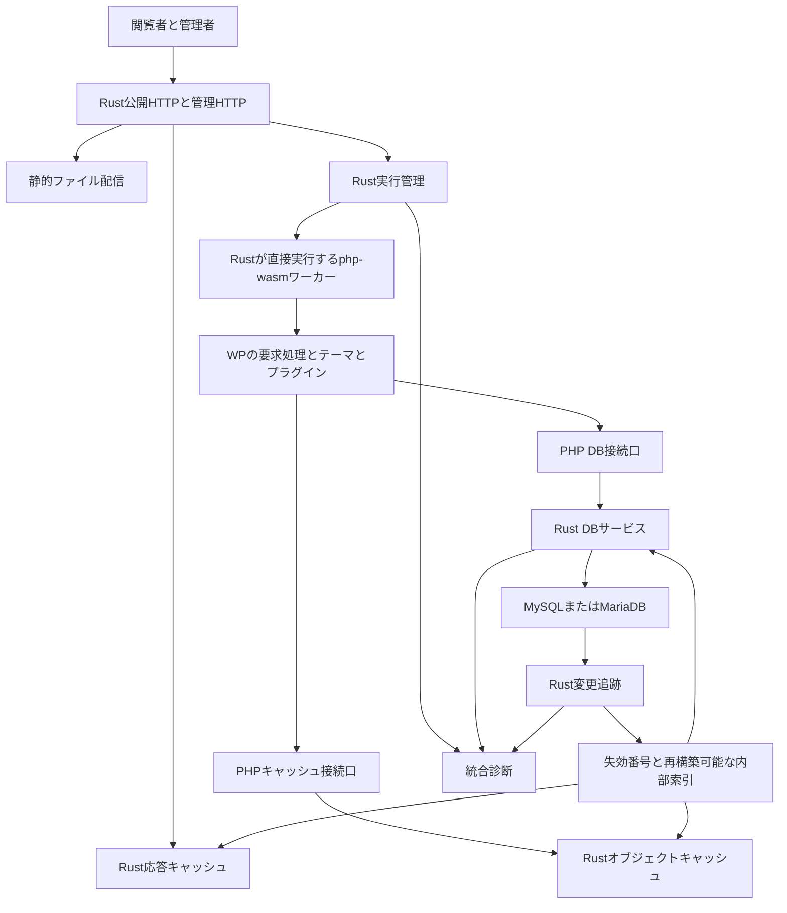

# RecastPress 新構成の基本設計案

作成日：2026-11-01（日本時間）  
版：0.5  
対応する実装の開始版：0.5.0  
位置付け：[概要設計案](README.ja.md)を具体化する構成提案

## 1 全体構成

Rustが外部HTTPの入口を所有する。php-wasmはサーバー内部で動作し、PHPソース・Wasm・DB資格情報を閲覧者へ配布しない。外部URLの互換性を保つため、必要な `.php` のURLやWP固有ルートは維持できる。実行基盤の隠蔽は、WPであることやURL形状の秘匿を保証する意味ではない。

図のDB接続口は契約上の境界であり、既存php-wasmへそのまま接続できる実装済みAPIではない。採用済みのDB互換方針A案では標準の `$wpdb` APIを維持し、プラグインによるmysqli接続・driver内部の直接操作を拒否する。この範囲を満たす接続方式を[詳細設計](detailed-design.ja.md)第3章の実証で選ぶ。

## 2 責務の分担

| 責務 | Rust側 | PHP側 |
| --- | --- | --- |
| HTTP | Host・サイズ・期限・ヘッダー、静的配信、応答の確定 | WPルートの意味、WPが生成するstatus・header・body |
| 初期化 | コード版・設定版・実行ロールの固定、ワーカー確保 | WP初期化、テーマとプラグインの読込み、標準フック |
| 投稿と検索 | DB実行、互換性を確認した索引、計測 | WP_Query、検索条件構築、投稿状態、保存フック |
| 認証と認可 | 管理経路と内部制御APIの保護、信頼できる内部通信 | WPの標準認証・権限・nonce、プラグインの操作別認可 |
| SSO | 独自OIDC機能の構成・外部応答検証・手続き状態の候補 | WPユーザーへの連携、標準セッションへの移行 |
| キャッシュ | 保持、容量、期限、原子操作、失効、適格性の強制 | WPのキーとグループ、明示的な依存・保存禁止情報 |
| 拡張管理 | 成果物検査、予約領域、許可能力、導入・更新の確定 | 許可された導入・更新処理、標準フック |
| DB | 接続・トランザクションセッション、SQL実行、結果、追跡 | 互換API、SQLの生成、WP側の副作用 |
| 永続保存 | 独自状態、成果物の版、実行管理の永続記録 | WPのテーブルと値の意味 |

同じWP認証状態・権限・投稿状態をRustとPHPで独立に再実装しない。Rust内部APIに必要なactorは、WPの認証結果を受け取る認証済みの接続口で発行する。ブラウザーのヘッダーやPHPコードの任意のuser_idだけを信頼しない。

同一PHP要求内の拡張コードは、WPの広い能力を共有する信頼対象として扱う。ワーカーへの認証は「どのワーカーからの要求か」を示し、同じワーカー内の個別プラグインが正当に認可されたことまで証明しない。

## 3 プロセスと資源

### 3.1 初期のプロセス案

公開Rust HTTP、管理Rust HTTP、内部DB・キャッシュサービス、php-wasmホスト、変更追跡を論理的に分離する。公開・管理HTTPの別プロセスという元案を引き継ぐ。DB・キャッシュサービスと変更追跡を同一Rustプロセスへまとめるかは資源測定後に決める。

**決定 2026-11-01**：php-wasm実行ホストはB案を採用し、Node.jsを製品の実行依存にせず、RustからPHPのWasmを直接実行する。Rustホストを独立workerプロセスにするか、どこまで同一プロセスへ組み込むかは、回収と資源制御の実証後に決める。Node.jsをなくすことを、workerの別プロセスも廃止する決定とは扱わない。

Playground系php-wasmはEmscriptenのPHPとJavaScript側の環境機能から成る。既存配布物をRustのWasmエンジンへ渡せばそのまま動くとはせず、既存のWasmtime Component実験ともABIを同一視しない。Rustへ接続できるPHPのWasmビルド、入口、I/O、ファイル、DB・cache呼出し、中断等の成立をP0の実証条件にする。[PHP.wasmのパッケージ構成](https://developer.wordpress.org/playground/developers/architecture/php-wasm-packages/)、[実行基盤](https://developer.wordpress.org/playground/developers/architecture/wasm-php-overview/)

具体的なPHPビルド、Wasmエンジン、ABI、ホスト機能、必要な追加runtimeの有無と各版は未採用とし、依存・ライセンス・実行条件とともに選ぶ。Node.js以外のJavaScriptエンジンを組み込むことも自動採用しない。Rust直接実行が成立しなければ設計判断へ戻り、本番をNode.jsやネイティブPHPへ自動フォールバックさせない。通常PHPは比較試験の基準として使用する。

### 3.2 ワーカーの役割

| ワーカー | 用途 | 制約 |
| --- | --- | --- |
| 公開処理 | 公開ページ、検索、フィード、公開REST等 | 管理専用秘密を渡さず、WPによる公開判定・必要な認可を実行する。通常処理に必要な標準wpdb経由の書込みを許可する |
| セッションを扱う処理 | ログイン、認証済み表示、コメント、状態変更API等 | 応答共有を禁止し、WPの認証・認可・CSRF等の検査を維持する |
| 管理処理 | 編集、設定、許可済み拡張の管理 | 管理経路を保護し、ファイル変更は導入制御に集約する |
| 内部処理 | 予約・cron・再構築・更新準備等 | 永続実行記録と能力制限を持つ |

**決定 2026-11-01**：公開処理のDB書込みはA案を採用し、公開GETを含む通常のWP処理に必要な書込みを標準wpdb APIとRust管理DB経路から許可する。公開閲覧を一律の読取り専用にはしない。操作の認証・認可・入力検査はWPとプラグインが担い、Rustの接続管理だけで業務上の認可を代替しない。

URLやHTTP methodだけで書込み能力・認証要否を決定しない。拡張が登録するルート・操作と必要能力を診断し、解決できない構成を読み取り専用ワーカーへ無理に載せない。DB直接接続、本体制御状態の改変、DB管理権限を許す変更ではなく、独自テーブル・DDLも別判断とする。初期段階で複数ロールを共通プールにまとめる場合も、公開キャッシュを無効にした状態から検証する。

### 3.3 隔離の限界

**決定 2026-11-01**：PHP実行の隔離はA案を採用する。受入済みテーマ・プラグイン・WPコードは同じ要求のPHP環境で実行し、global・フック・objectを共有する。実行基盤の隔離単位はサイト・役割・ワーカーとし、個別プラグイン間の完全隔離は保証しない。拡張ごとの別Wasm環境と、その間の標準フック・共有objectの仲介を初期の必須構成にしない。

同じPHP要求内の受入済みコードは一つの信頼範囲となり、一つの拡張の障害や状態変更が同じ要求へ影響し得る。要求間のCookie・actor・global等の分離と、Rust側の本体専有領域・DB経路・ファイル権限の保護は維持する。プラグイン衝突の拒否、疑いが解消しない場合の保留・RP開発者への報告も変更しない。

Wasmであっても、ホストが許可したファイル・DB・ネットワーク能力は利用できる。ホストのOS権限、mount、接続先制限も合わせて設計する。

## 4 HTTP要求の流れ

1. Rust HTTPがHost、長さ、要求の構文、接続期限を検査する。転送元の信頼条件を決め、外部から内部actor・ロールを指定させない。
2. 静的資産の許可パスならPHPを経由せず配信する。PHPソース、設定、秘密、内部メタデータを静的公開しない。
3. 応答キャッシュの事前適格性と追跡状態を検査する。保存禁止・個人別・状態不明の要求はキャッシュを迂回する。
4. ヒット時も現在のコード版・失効番号・追跡条件を確認し、最終応答へ進む。
5. ミスまたは非対象なら、固定した実行版と役割でワーカーを確保する。
6. PHPがWPを初期化し、同じ要求内でテーマ・プラグイン・フックを実行する。DBと共有キャッシュは本体の接続口を通す。
7. RustがPHP応答のstatus、headers、cookies、bodyを受け取る。ヘッダーは複数値と順序が必要なものを保持し、改行注入等を拒否する。
8. PHP側の保存可否情報とRust側の条件を合わせ、許可された応答だけ保存する。実行中の失効、書込み、コード切替があれば保存しない。
9. bodyをtransportへ渡す直前まで失効条件を確認する。送信済みbytesは回収できないため、配信開始後の撤回は別契約に従う。
10. 要求状態を破棄し、DBセッション・一時ファイル・リソースを終了処理する。清掃を確認できないワーカーは再利用しない。

応答キャッシュの保存可否を確認できない処理は、採用済みのA案に従い毎回PHPで実行する。キャッシュ可能性だけを理由にテーマ・プラグインを拒否しない。影響を特定の要求や経路へ限定できない場合は、サイト全体の応答キャッシュを停止し、状態と理由を表示する。オブジェクトキャッシュ・DB最適化まで一律に停止せず、それぞれの成立条件を確認する。

**決定 2026-11-01**：動的応答の送信はA案を採用し、初回はPHP応答を有限サイズのバッファへ完成させてから確定・送信する。通常のecho等の出力は扱うが、生成途中の内容が即時に閲覧者へ届くことを必須とする機能、SSE等は初回非対応とする。動的応答のストリーミングを将来の確定実装予定にはせず、必要になった時点で別に検討する。

RustホストがPHPの出力を内部で順次受け取ることは可能とし、外部への送信開始とは区別する。出力上限・期限超過、実行異常時は途中の成功応答を出さず、失敗応答と回収へ進む。既に確定したDB書込みや外部副作用まで取り消されるとはしない。静的ファイルの大容量配信・Rangeの契約は維持し、動的PHP出力の制限と混同しない。

## 5 保存と変更反映の流れ

1. PHP側で標準の認証・認可・入力検査・保存フックを実行する。
2. Rust DBサービスは、その要求のDBセッション上でSQLを実行する。WPの複数SQLを無断で一つのトランザクションに包まない。
3. 書込み開始時に最適化の利用を抑止し、更新中に古い値を共有保存しない。実際のCOMMIT・失敗・不明な結果を区別する。
4. 確定した変更で応答キャッシュと対象の内部データを失効させる。binlogとの対応が取れるまで、その変更に依存する高速経路を再開しない。
5. PHPの処理終了、DB保存の確定、キャッシュ失効の完了、内部索引の反映完了を別状態として記録する。
6. 内部索引が遅れている間も、正常なDB経路でWPが応答できるようにする。

外部更新は非同期追跡となる。変更発生直後から常に最新という保証を置かず、最大反映遅延、追跡不能の判定、非公開化の期限を[詳細設計](detailed-design.ja.md)第5章で契約化する。

## 6 キャッシュとDBの正本

正本はMySQL／MariaDBのWP互換領域と、管理されたメディア・コード・設定とする。キャッシュと内部索引は再構築可能な派生物である。キャッシュを消せばDBの不整合が修復されるとはしない。

PHPはWP固有の意味を担い、Rustはアクセスと保存の基盤を担う。任意SQLをRustのメモリ検索へ自動翻訳する方式を初期仕様にしない。型、照合順序、NULL、重複、順序、可視時点を含めて同等性を確認した経路だけを高速化する。

## 7 本体の専有領域

本体が提供するDB接続、オブジェクトキャッシュ、応答キャッシュ、失効管理、実行管理、内部制御APIとその接続コードを予約する。テーマ・プラグインがこれらを差し替える構成を拒否する。

複合プラグインの扱いは採用済みA案に従い、一部に衝突機能を含む場合、初回はプラグイン全体を拒否する。機能ごとの設定や無効化profileによる部分的な受入れは初回に提供しない。衝突を確定できない場合の保留・RP開発者への報告とは区別する。

公開・管理・内部ワーカーのDB資格情報はRust DBサービスが保持する案とする。HTTP入口や一般PHPコードには生の資格情報を渡さず、DBサービスへの接続能力を与える。この能力自体がDB操作を許すため、パスワードを隠すだけでDB安全性を達成したとはしない。

動的WP実行は、初期化・認証・拡張のために非公開データを含む正本へアクセスし得る。旧案の「公開実行系には非公開データを一切渡さない」という境界は、そのまま維持できない。公開Rust HTTPからの秘密分離、内部実行系への能力制限、PHP側の公開判定へ責務を変更する。一般SQLを許すworkerにDB権限がある場合、同じworker内のpluginをSQLの操作者ごとに完全隔離できるとはしない。

通常の `$wpdb` 経由SQL、標準フック、カスタム投稿型、ショートコード等を、基盤への侵入として一括禁止しない。独自テーブル・DDL・外部通信は許可能力として別に扱う。

mysqli接続handle・driver固有resultを直接利用するプラグインは受入れ対象から外す。本体接続コードの内部実装でdriverを使うことは禁止せず、その内部をプラグイン向けの互換契約へ含めない。

検査で具体的な基盤衝突の疑いが生じ、解消できない場合は、有効化を保留してRP開発者への報告を求める。保留理由、対象の版・hash、診断情報をまとめて提示し、調査結果に基づく再検査へつなぐ。単に未検証であることや、応答キャッシュ可能性だけが不明であることを同じ保留理由にしない。

通常の互換性報告は採用済みA案に従いGitHub Issuesを使う。製品は秘密情報を除いた診断と報告文を提示し、利用者が確認して投稿する。RPからの自動投稿や専用の非公開受付サービスを初期構成へ追加しない。報告受付と有効化の再判定は別の状態とする。

## 8 永続状態と版

| 状態 | 保存先の案 | 要点 |
| --- | --- | --- |
| WPコンテンツ・ユーザー・設定 | WP互換DB | 元の値と関係を維持 |
| メディア | 管理されたファイルまたはオブジェクト保存先 | DBと対応するバックアップ単位 |
| WP・テーマ・プラグイン | 版付きの不変なコード束 | 本体だけが有効版を切り替える |
| 拡張審査・設定・監査・ジョブ | 独自の永続領域 | WP互換領域と分離 |
| 追跡位置とsource identity | 整合確認付きのcheckpoint | 再起動時に新旧・別sourceを判定 |
| キャッシュと内部索引 | 主にオンメモリ | 再起動後は再構築・空から開始可能 |

WP基準版、PHP版、php-wasm版、ホスト版、DB版、接続契約版、拡張束版、設定版、失効番号、source identity・追跡位置を区別する。複数プロセスの失効番号は中央の正本を持ち、各プロセスが独立採番しない。

## 9 管理画面と運用

標準のWP管理画面を利用し、独自機能は追加1画面へ集約する。キャッシュ設定のon/offと実稼働を分け、監視待ち・容量不足・コード変更・接続障害等の理由を表示する。容量の手動入力欄は設けない。

**決定 2026-11-01**：同梱基盤の更新はA案を採用し、Rust本体、同梱WP、php-wasm、実行ホスト、接続コードをRPの検証済みリリースとして一体管理する。RP開発者が修正の取込み、組合せ検証、配布を担う。利用者による同梱部品の独立更新は提供せず、WP標準のコア更新処理もRPの管理を迂回させない。

ホストOS、Docker、外部DB、第三者テーマ・プラグインの任意更新は同じ本体更新へ混在させない。自動適用する版の範囲、適用時刻、停止条件、DBスキーマ変更時の復旧は引き続き具体化する。固定するWP比較基準と、保守・セキュリティ修正の配布方針は区別し、基準を変更する場合は対応するリリースと比較結果を明示する。

## 10 外部仕様の参照

- [PHP.wasmパッケージ](https://developer.wordpress.org/playground/developers/architecture/php-wasm-packages/)：既存のJavaScript依存と、Rustホストで別途実現する機能を調べる資料。
- [PHPProcessManager](https://wordpress.github.io/wordpress-playground/api/universal/class/PHPProcessManager/)：再利用・待機の比較資料。Node向けAPIの製品採用や、Rustでの直接利用を示すものではない。
- [WPのキャッシュ初期化](https://developer.wordpress.org/reference/functions/wp_start_object_cache/)：本体専有のobject-cache接続口の検討先。
- [WPのDB初期化](https://developer.wordpress.org/reference/functions/require_wp_db/)：db.php等の接続境界の検討先。

参照日は2026-11-01。公式Web資料は実装境界を調べる資料であり、WP互換試験の正本は固定した配布ソースと環境とする。
