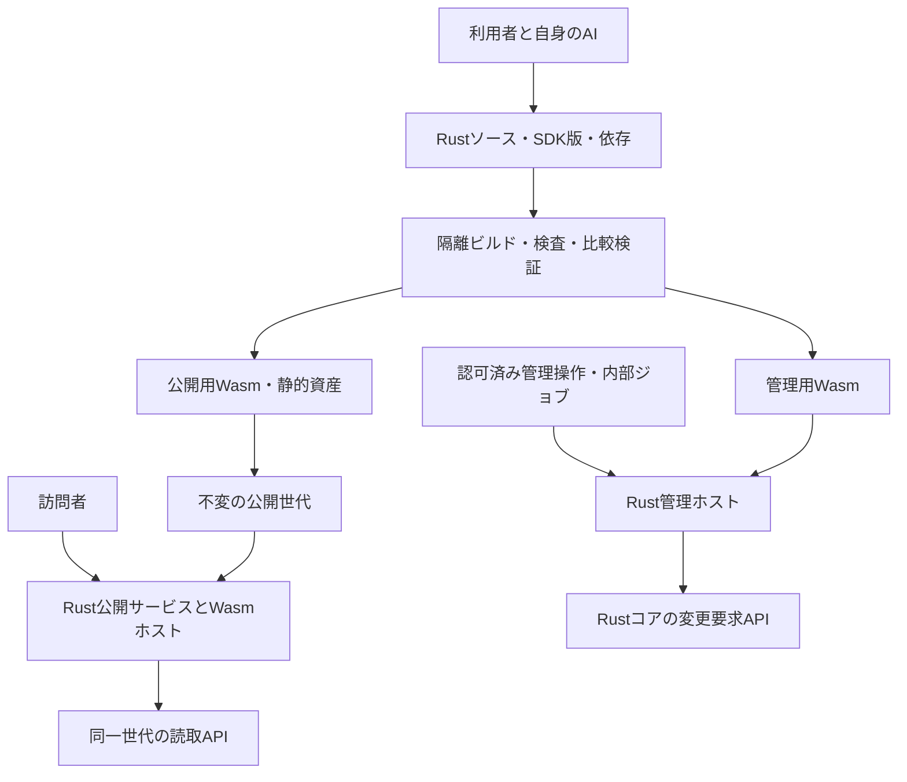

# テーマ・サイト拡張のWasm実行と成果物契約

更新日：2026-10-30（日本時間）。D04の実行方式は決定済み。以下は製品SDK・成果物・実行契約の設計案であり、製品への採用と性能検証は未完了。固定WATを使う独立実験の実装・観測とは区別する。

## 現在の実装との対応

`experiments/wasm-runtime-probe`、`wasm-component-probe`、`wasm-publication-probe`、`wasm-request-probe`、`selected-wasm-consumer` は、それぞれ独立workspace／lockの固定fixture実験である。Wasmtime 36.0.19でcore／Componentの呼出し、所有copyとpost_return、startup生成後のsealed HTTP、独立loopbackでの要求ごとのfresh Store、同一世代の選択pageからの描画を有限に観測した。Rustテーマを生成・ビルドするSDKや、製品serverの要求処理へ接続したengineではない。Component Model／WIT／ABI・engine版の製品契約は本書の残件として維持する。

製品coreには準備済みpageの世代管理と[同一世代の選択](selected-public-pages-development.ja.md)、serverにはstartupで封印したbundle／receiptの配信と[CSS／JS資産](sealed-public-assets-development.ja.md)がある。選択後にlock外でguestを実行し、最後に完成bytesだけを配信gateへ渡す構成は[独立consumer](selected-wasm-consumer-development.ja.md)で試した。guestのhost importは試験用checkpointだけで、以下のSDK host APIを実装したものではない。

各開発文書のcheckpointは、その保存時点と追跡sourceに対する履歴である。最新の認証cookie検証MAIN変更後の全体gate・証跡再生成は未完了であり、過去の全成功を現在tree全体の成功へ読み替えない。native Linux実行、実テーマ・三環境の性能／資源試験も未完了である。

## 1. 実行方式の決定

**決定**：利用者が自身のAIで移植したRustソースをWasmへビルドし、RecastPressのサーバー上で実行する。閲覧者のブラウザーへテーマの実行を移す方式ではない。AI操作は利用者が製品外で行う。

| 比較した方式 | 更新・配備 | 権限・障害の扱い | 結果 |
| --- | --- | --- | --- |
| RustからWasmへビルド | 本体と別の成果物として更新できる構成にする | ホストが提供するAPIと実行資源を限定。エンジンの追加・検証が必要 | 初回の標準として採用 |
| Rust本体へ組込み | テーマ変更ごとにサイト用バイナリを再ビルド・配備 | 本体と同じプロセス資源を共有。役割ごとの実行環境が必要 | 標準として未採用 |
| 別Rustプロセス | OS・CPU別の実行ファイルとプロセスを更新 | OS隔離と通信契約が必要 | 標準として未採用 |

通常のRust ABIには安定性保証がないため、任意版で生成したRust動的ライブラリをそのまま交換する契約にはしない。[Rust Reference](https://doc.rust-lang.org/reference/items/external-blocks.html)

詳細案はComponent Modelと型付きインターフェースを用いる。エンジンはWasmtimeを調査候補とし、採用版・features・推移的依存・配布ライセンスを固定してから選定する。WasmtimeのLICENSEにはApache-2.0とLLVM例外があるが、これだけで配布構成全体のGPLv2互換性監査を完了したとは扱わない。[Component Model](https://component-model.bytecodealliance.org/design/why-component-model.html)、[Wasmtime LICENSE](https://github.com/bytecodealliance/wasmtime/blob/main/LICENSE)

## 2. 配備前ビルドと公開経路

公開リクエストではRustコンパイラーやビルドジョブを起動しない。公開前にビルドと必要なモジュール準備を終え、各インスタンスのロードは準備完了判定に含める。JIT／AOTの採用、コールドスタート時の内部コンパイルは別途計測する。必要な生成物がない場合もPHPやビルド処理へフォールバックしない。

配備単位は、公開用Wasm、必要な管理用Wasm、静的資産、契約・依存情報、検証結果を束ねた版とする。管理コードが不要なら管理用モジュールは省略する。D05・R33で公開系と管理系のRustは別プロセスに決定した。ホスト・コンテナ、コメント担当・ワーカー等の具体的配置は詳細化する。

## 3. 受入れるソースと成果物

ファイル名・形式は案。実ファイルや配備設定は本設計作業では作成しない。

| 情報 | 内容と受入条件 |
| --- | --- |
| モジュール識別 | module_id、版、用途（公開／管理）、親子テーマ・サイト拡張の依存関係 |
| 元資料 | 元テーマ・functions.php・読み込み先のハッシュ、基準WordPress版、元コードから移植先への対応表 |
| Rustソース | Cargoプロジェクト、SDKの固定版、Cargo.lock、Rust toolchain・ターゲット・features。取得先・内容ハッシュも記録 |
| API契約 | interface_version、必要なAPI群・能力、入口、利用する標準APIと未対応事項 |
| Wasm成果物 | ビルド元ソース・依存と対応する成果物ハッシュ、import/export一覧、用途、検査結果 |
| 静的資産 | CSS・JS・画像・フォント、内容ハッシュ、MIME、URL対応。PHPソースや設定を公開物へ混入させない |
| 検証情報 | 比較データ版、シナリオ、合否、不一致、未検証範囲、適用ホスト版・制限設定 |

標準経路ではソースを受け入れて製品のビルド手順でWasmを作る。利用者が外部で作ったバイナリのみを取り込む経路は別途検討し、ソース・由来・検証を省略する承認とはしない。CPUやエンジン版に依存するコンパイルキャッシュは配布する標準Wasmと区別し、版やハッシュが一致しなければ再利用しない。

## 4. SDKとモジュールの呼出し契約

SDKは利用者・AIがRustで書くためのAPI、モジュール境界はバージョン付きの型付き契約として分ける。以下の識別子は仮称。SDK型のメモリ配置やRustの関数ポインターを境界の仕様にしない。

| 入口案 | 入力 | 出力・責務 |
| --- | --- | --- |
| 登録・初期化 | 役割、設定スナップショット、対応するAPI群 | テンプレート・資産・フック等の宣言。要求ごとの投稿状態と共有しない |
| 公開描画 | request_id、site_id、generation_id、テーマ版、ページ種別、クエリ・言語・日時・公開設定 | HTML、必要資産、許可済みのヘッダー・キャッシュ情報。HTTP応答の最終確定はコアが行う |
| フック呼出し | 実行コンテキスト、フック名、callback_id、引数・状態 | フィルター戻り値、状態変化、診断。順序・再入・登録解除は基準WPと比較 |
| 管理操作 | コアが認可したactor・operation_id・対象・base_revision | 型付き変更要求。Rustコアが入力・権限・競合を再検査して適用 |
| 内部ジョブ | job_id、起因、対象改訂、許可能力、冪等キー | 型付き結果・変更要求・監査情報。公開経路のジョブ投入には流用しない |

PHP APIとの意味対応はレジストリで追跡する。null・false・整数・浮動小数点・バイト列・UTF-8文字列・順序付き配列・整数／文字列キーを区別し、必要に応じて型付き値や要求内だけ有効な資源IDを用いる。オブジェクト同一性・参照更新は個別契約と比較試験が必要であり、単純なシリアライズで再現済みとはしない。

フックはモジュールID・callback_id・コンテキストで識別し、優先度、同順位順序、親子テーマ順序、実行中の登録変更、入れ子、出力と戻り値を契約化する。単体APIを全て用意するだけで、組み合わせたWP動作の互換性が得られたとは扱わない。

SDK版、境界契約版、基準WP版、テーマ版、公開世代を別項目で記録する。契約版の互換範囲と必要能力をロード前に照合し、同じメジャー番号という理由だけで意味互換を保証しない。

## 5. 公開・管理の能力

| 能力 | 公開ホスト | 管理・内部ジョブ用ホスト |
| --- | --- | --- |
| 投稿・分類・設定の取得 | 同一公開世代の公開データだけ取得 | 認可された編集用スナップショットを取得 |
| クエリ・検索・テンプレート | Rustが検査する型付き要求。世代・サイトをホストが固定 | 対象操作の権限内で使用 |
| 編集・設定・公開切替 | 提供しない | コアへの変更要求。モジュールの自己申告actorを信用しない |
| PHP実行・PHPジョブ投入 | 提供しない | Wasmへ汎用PHP起動APIを渡さない。既存PHPプラグインの実行は認可済み実行管理側で統括 |
| 外向き通信・メール | 既定では提供しない案。必要なRust公開機能はD10で個別設計 | 能力別API。許可範囲・再試行・副作用をD08と整合 |
| OS・DB・ファイルへの直接アクセス | 提供しない | DBやOSの資格情報を渡さず、必要なコアAPI・一時領域だけを設計 |

ホストが渡したimportだけをWasmが利用する設計を基盤にし、WASIのネットワーク・環境変数・ファイルを無条件で引き継がない。公開ホストに管理APIを実装し、モジュールのフラグだけで無効化する設計は避ける。公開用成果物に未知・禁止importがあればロード前に拒否する。[Wasmtimeの境界説明](https://docs.wasmtime.dev/security.html)

公開SDKの読取りAPIから管理側のオンデマンド処理、PHPフィルター、WP-Cron相当を呼び出さない。PHPだけにある表示処理の依存が残っていれば、その成果物は受入れ不可とする。

R26の新規コメント受付は、公開表示用Wasmの書込み能力として提供しない。フォームはRustの限定受付へ送信し、受付・検査・管理判断・公開反映をRust専用経路で処理する詳細案。管理側でコメントを扱うWasmにも、その操作に不要なPHP処理や汎用書込みへ到達する能力を渡さない。R27により受付・承認設定はWP準拠、初期受付は無効。フォーム・条件API・直接送信の判定を揃える。個別契約と移行元設定の扱いは[コメント方針](comments-policy.ja.md)を参照。

## 6. 状態・制限・失敗

要求ごとの投稿・クエリ・ループ・利用者・翻訳状態は共有しない。モジュールコードや検証済みコンパイル済み表現を共有しても、可変インスタンスの共有は別に管理する。プール再利用時は状態初期化の同等性を試験し、確認前は要求ごとに独立した状態を使う案とする。

同一要求のデータ取得はgeneration_idまたは編集改訂に固定する。主クエリと副クエリの保存・復元、キャッシュキーとテーマ版の対応を検証し、要求途中で新世代へ混在させない。

メモリ総量、インスタンス数、実行期限、計算量、ホスト呼出し件数、クエリ件数、入れ子深度、HTML・ログ出力量を制限する。数値はD14で決める。Wasmの計算量制限だけではホストDB呼出しの時間・結果サイズを制限できないため、ホスト側にも期限と上限を持たせる。[実行中断](https://docs.wasmtime.dev/examples-interrupting-wasm.html)、[メモリ等の制限API](https://docs.rs/wasmtime/latest/wasmtime/struct.StoreLimitsBuilder.html)

エラーは契約不一致、未対応API、権限不足、世代不一致、期限・資源上限、trap、比較不一致に分ける。公開描画の失敗は失敗応答と監査用相関IDを返す案とし、生成途中のHTMLを成功として配信しない。旧世代への自動差戻しは、非公開化・削除済みデータを再露出させ得るため既定では行わない。

管理モジュールのtrap時は未確定の変更要求を公開しない。メール等の外部副作用が既に発生した場合の再実行・回復はD08と連携し、Wasmが止まれば副作用まで巻き戻ったとは扱わない。

## 7. ビルド・検証・更新

依存取得とコード実行を分ける。固定した依存・ツールを用意してから、秘密情報・本番DB・配備権限のない隔離環境でビルドする。build.rsはビルド前に実行され、手続きマクロもコンパイラーの資源へアクセスするため、Wasmへ出力することだけではビルド時の隔離にならない。[Cargo](https://doc.rust-lang.org/cargo/reference/build-scripts.html)、[Rust Reference](https://doc.rust-lang.org/reference/procedural-macros.html)

新しいモジュール・資産・設定スナップショットを検証し、不変キーへ保存する。初期化・必須import・比較検証が通ってから、テーマ版と公開世代の参照を一緒に切り替える。処理中の要求の継続は世代整合と失効検査を満たす範囲に限り、旧世代の無条件配信を認めない。現在のcoreはreplace／withdraw後の旧response／selectionを配信時にStaleとして拒否する。保持した旧bytesの読取りと配信許可は別であり、既にtransportへ渡したbytesの撤回は保証しない。対応版と保持期間の範囲での復旧にも公開撤回条件を維持する。RustコアやSDK更新で契約が変わる場合は、互換確認・必要な再ビルド・再検証を行う。

テーマと独自投稿型などのサイト機能を別モジュールに分けるかは未決。共通の成果物契約にmodule_idと依存関係を設ける案とし、テーマの見た目変更だけでデータやサイト機能を削除しない。

### 7.1 本体二系統切替とWasmの世代（D27-02・R57）

**決定（2026-10-25）**：スキーマ変更なしの更新は、Rust本体全体を一時的に二重起動して切り替える。無停止は保証しない。検証を省略する指定ではなく、W03・W06、T14・T33・T35の検証計画は維持する。

各Rust系統は対応するWasm・資産・契約・設定を準備し、新規要求を新側へ切り替える詳細案。旧要求は世代整合と失効検査を維持して完了後に解放する。公開・管理の役割分離、要求状態の隔離、各世代のインスタンス群は従来契約を維持する。

切替時の全パージと、コードを切り戻す場合の現在の公開データ・非公開化・権限の保持を設計する。Wasmだけの二世代切替は補助案として区別し、Rust本体の二重起動を省略する根拠にしない。スキーマ変更を伴う更新の方式は未決。追加メモリ・Storeの寿命・処理中要求・新旧契約・データ意味の互換性と失敗時の復旧は[更新設計3.3](automatic-updates.ja.md)で具体化し、将来検証する。実装・試験は未実施。

## 8. 受入試験案と残件

| ID | 検証内容 |
| --- | --- |
| W01 | RustソースからビルドしたWasmと元テーマで表示・フック・編集・公開シナリオを比較 |
| W02 | 公開成果物の管理・PHP・禁止WASI importを拒否。許可API経由でもPHPや管理ジョブへ到達しないことを検証 |
| W03 | 無限ループ・過大メモリ・巨大出力・DB低速で実行を打ち切り、他要求と既存公開世代を維持 |
| W04 | 同時要求とインスタンス再利用で主／副クエリ、投稿、言語、利用者状態が混ざらない |
| W05 | モジュール・SDK・契約・ハッシュ不一致、初期化失敗時に公開切替を止める |
| W06 | 版更新の途中失敗・要求中の切替・復旧で、Wasm・資産・データの世代が混在しない |
| W07 | ビルドスクリプト・手続きマクロが本番秘密情報・配備権限へ到達できない |
| W08 | 三つの初回公式配備環境で準備時間、初回／温間描画、CPU・メモリ・ホスト呼出し費用を測定 |

[基準WordPress版](wp-compatibility.ja.md)は7.1.3で決定済み。同版に残る非推奨の標準テーマ用APIも含める。初回は単一サイト先行で、ネットワーク固有機能は後続対応。WPコア標準を基本仕様とし、公開・管理Rustは別プロセス。残件はAPI母集合、Component Model・WIT・WASIの採用版、エンジンとGPLv2互換構成、D05の具体的配置・資格情報・内部通信、D08の副作用、D10の標準仕様照合と実現方式、D14の数値、初回検証テーマ群。Wasm方式の選択は、これらの性能・互換・配備試験が合格したという意味ではない。
