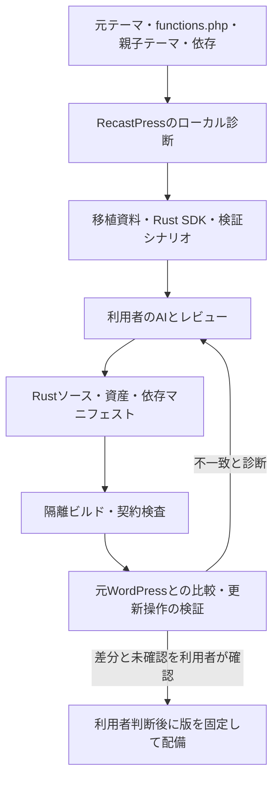

# 利用者のAIによるテーマ・functions.phpのRust移植

更新日：2026-10-30（日本時間）。D04の役割分担とRust→Wasmの実行方式は決定済み。製品SDK・成果物・権限等の詳細は設計案。固定WATの独立実行実験と、手動の入力・比較・受入れtoolは部分実装しているが、実テーマの移植・製品Wasm実行・自動移行診断は未完成である。

現在は明示URLのHTTP記録、二記録／明示pair一覧のoffline比較、選択したsourceのinventory、PreparedPosts入力のブラウザー内編集・import・JSON／固定ZIP export、nativeのprepare／check-package／unpack-packageがある。ZIP内のbundle／receiptはnative admissionで検査でき、固定例でsealed HTTPまで確認した。これらは利用者が明示した入力を扱う開発導線であり、サイト巡回、自動対応付け、PHP変換、DB同期、公開判断や自動publishではない。PreparedPostsはliteral textであり、WP formatterのentity出力を自動適用しない。

Wasmの実観測は[独立実験と製品契約の区別](theme-module-contract.ja.md)を参照。V3のCSS／JSは準備済みassetとして配信し、JavaScriptはbrowserで実行する。サーバー側で実行するテーマWasmのD04方針を変更したものではない。保存checkpointは当時のsourceに対する履歴で、最新の認証cookie検証MAIN変更後の全体再検証は未完了である。

## 1. 決定した役割分担

**決定（2026-10-25）**：利用者が自身の契約したAIを操作してテーマとfunctions.phpをRustへ移植し、RecastPressが移植先API・移植資料・診断・テスト支援・成果物の技術的検査・配備を提供する。移植、テスト結果の確認、公開判断は利用者または委託先の責任。利用者が選ぶAIはクラウド型でもよい。契約・課金・コード送信・AIへの修正依頼は利用者とAIサービスの間で行う。

RecastPressはAI APIへ接続せず、AIキーを保持せず、AIモデルを実行しない。成果物の受入れはAIの製品名・契約・応答形式に依存させない。移植済みソースと固定したSDK・依存・ビルド条件から再構築する詳細案とする。

AIを移植に使っても、動作の同等性は別途検証が必要。独自PHPコードの移植・修正と結果確認は利用者または委託先が担い、標準APIの意味・成果物の技術的受入条件・診断はRecastPress側が担う。Wasmへ変換・読込みできない成果物は失敗として公開しない。実行できることや有限の比較試験を、サイト移行成功の証明にしない。

**追加の提供要件（2026-10-25）**：利用者または委託先が作業を進められるよう、製品方針と責任分担の説明、診断結果の読み方、AIへ渡す資料、移植用とテスト用の具体的なプロンプト、生成物の提出、ビルド・比較検証、不一致時の修正依頼、切替までの手順を提供する。プロンプトは元サイトの診断結果とSDK版に対応させ、未対応事項を隠して成功と指示しない。functions.phpをカスタムできる開発者なら対応できるという見立ても含め、手順の実行可能性は代表サイトで検証する。個別サポートや受託作業を製品提供の前提にしない。テスト通過でもサイト移行成功や全機能の同等性は保証しない。

## 2. 処理の流れ

利用者が製品外でAIを使用する。本番は検証済み成果物を実行し、公開閲覧からAIやPHPを呼び出さない。移植資料の出力とRustソースの受入れを製品境界にし、その間のAI操作を製品の自動処理に含めない。

## 3. RecastPressが提供する契約案

開発用の部分実装として、callerが選んだ単一URLのHTTP応答を保存する[手動baseline tool](http-baseline-development.ja.md)がある。これはsite診断、URL自動抽出、画面取得、SDK生成、移植成果物の検査を実装したものではない。取得済み資料の私情報は利用者が確認し、AIへ自動送信しない。

| 提供物 | 内容 |
| --- | --- |
| 移植資料 | 基準WP版、元ファイル一覧とハッシュ、標準API・独自関数・フック・依存の診断、未解決箇所 |
| Rust SDK | 投稿・クエリ・ループ・設定・翻訳・エスケープ・資産管理等の型付きAPI。標準APIとの対応と意味の差を記載 |
| 移植先構造 | 公開描画、登録・設定、管理操作、保存フック、内部ジョブの各入口と権限 |
| AI向け資料 | SDK版・診断結果・元サイト記録に対応する移植用とテスト用の具体的なプロンプト、段階別手順・例・受入条件。特定AIに依存しないテキスト形式 |
| ソース成果物 | Rustソース、CSS・JS・画像、SDK版、依存の固定情報、元コードとの対応、未対応事項 |
| 検証 | 契約・API比較、HTML・表示・操作・データ整合性の比較、不一致の位置と再現条件 |
| 更新支援 | 元テーマ更新の差分、SDK互換性、移植ソースへの追従と再検証、以前の成果物への復旧 |

標準テーマ用API全体というR15は決定済み。移植元PHP APIとの対応表と、Rustでの使い方を提供する。SDKの最初の版に存在しないAPIを、AIが代替コードを生成しただけで標準API対応済みに数えない。

### 3.1 テスト用プロンプトの骨子（提供するテンプレート案）

現toolの範囲と未完成箇所を明示した[手動レビュー手順・移植用／比較テスト用ひな形](manual-migration-review.ja.md)を用意した。サイト別の自動診断・SDK生成・移植したテーマのWasm実行済みを意味しない。

移行診断はまず公開時PHP禁止、問い合わせフォーム分離、利用者の移植・確認・公開判断の責任を説明する。親子テーマ、functions.phpと読み込み先、フック、依存プラグイン等を列挙し、作業対象・未確認を表示する。元WordPressの代表URLを自動抽出し、運用者が重要なURL・操作を追加する。画面・HTTP応答は初回診断時に記録し、最終同期後の切替直前に再記録する。画面取得の方法は元ホストへのブラウザー導入を必須にしないよう詳細化する。

テスト用プロンプトは次の指示をサイト別の診断結果、元サイト記録、SDK版に合わせて具体化する。元コード・本番データ・秘密値をAIへ自動送信しない。

> 元WordPressの記録を期待結果として、移植後のRecastPressを検証するテスト一覧と実行手順を作成してください。代表URL、画面、HTTP状態・ヘッダー、検索・一覧・404、サイト固有の操作、更新後の反映を照合してください。期待結果を移植後の実装から推測しないでください。比較できない項目は「未確認」、差分は再現手順と証拠を記録してください。テストが通っても全機能の同等性やサイト移行の成功を宣言しないでください。

ビルドまたは読込みができない移植成果物は失敗として公開しない。実行できる成果物の表示差・動作差・未確認は支援機能で報告し、利用者または委託先が許容と公開可否を判断する。診断は網羅性や移行成功を保証する表示をしない。

## 4. functions.phpの扱い

functions.phpは任意のPHPコードを含み、管理画面と公開画面の双方で読み込まれる。親子テーマの読み込み順も動作に関係する。[WordPress公式](https://developer.wordpress.org/themes/core-concepts/custom-functionality/)

| 元コードの役割 | 移植先の案 |
| --- | --- |
| メニュー・サイドバー・テーマ機能の登録 | 初期化・登録API。親子テーマとフックの順序を維持 |
| 本文フィルター・ショートコード・動的表示 | 公開Rustモジュール。クエリ・時刻・利用者への依存を保存時の固定値に置き換えない |
| 設定画面・保存時の加工 | 認証・認可済みの管理Rustモジュール。公開側から同じ入口を呼べない契約 |
| 定期処理・外部通信・メール | 内部ジョブと能力別API。公開データ起点でのPHP実行禁止を維持 |
| 直接SQL・外部PHP・プラグイン依存 | 個別の移植・代替・未対応を明示。依存を黙って削除しない |

表示用のテーマ切替と、独自投稿型・データ更新などのサイト機能の無効化を同一にしない。サイト機能を独立したRust拡張へ分けるかは追加の設計論点とする。

## 5. 実行形態と検証の課題

Rust SDKを使っていても、生成したネイティブコードはファイル・ネットワーク・プロセス起動を行い得る。SDKの型だけを権限境界にせず、公開コードがPHP起動・管理資格情報へ到達できない実行環境を定義する。ビルド時のbuild.rsや手続きマクロも実行コードとして扱う。

**決定（2026-10-25）**：初回の標準実行方式はRustからWasmへビルドし、サーバー上で実行する方式。利用者がこの推奨案を選択した。本体と別に更新できる成果物とし、ホストがAPI・能力・資源を限定する詳細案とする。Component Model、具体的エンジン・版、性能、GPLv2互換構成は別途検証する。[成果物・実行契約](theme-module-contract.ja.md)、[Component Model](https://component-model.bytecodealliance.org/design/why-component-model.html)

初回の検証案は、元サイトの表示と移植先の表示に加え、投稿追加・編集・削除、分類・テーマ設定変更、親子テーマ、フック順序、検索・フォーム等の採用機能を比較する。コンパイルと有限の比較試験で任意入力に対する完全同等性を証明できたとは扱わない。

## 6. 要件への反映と残る設計

| 要件 | 現在の扱い |
| --- | --- |
| R10 任意PHPテーマの移植 | 利用者が自身のAIでRustへ移植する前提に更新。内蔵の汎用自動変換器を必須要件にしない |
| R14 AI非依存の製品処理 | 資料準備・成果物検証はAI接続なしで実行。利用者自身の外部AI利用とは境界を分ける |
| R17 AI利用の主体 | 利用者が契約・選択・操作。RecastPressはAI API接続・キー管理・モデル実行を担わない |
| R15・R19 標準テーマ用API全体 | 基準は7.1.3で同版の非推奨APIも含む。Rust SDKでの意味対応・個別API・比較ケースを具体化 |
| R03 GPLv2互換性 | SDK・生成ソース・元テーマ・依存・ランタイムの条件を確認 |

移植資料は元コード・依存情報を中心にし、実データ、秘密値、個人情報を既定で含めず、利用者が内容を確認して自身のAIへ渡す詳細案とする。伏せたデータと元サイトとの比較に必要なローカル検証データは分離する。

SDKの入口、成果物情報、公開・管理の能力、要求状態、制限、更新・失敗時の仕様を[成果物・実行契約](theme-module-contract.ja.md)に具体化した。[互換基準](wp-compatibility.ja.md)は7.1.3と同版の非推奨API、初回サイト構成は単一サイト先行で決定済み。残件は公開・編集機能、個別API、エンジン・契約版、プロセス配置、数値目標、初回合格テーマ群。決定済み事項を再質問しない。
