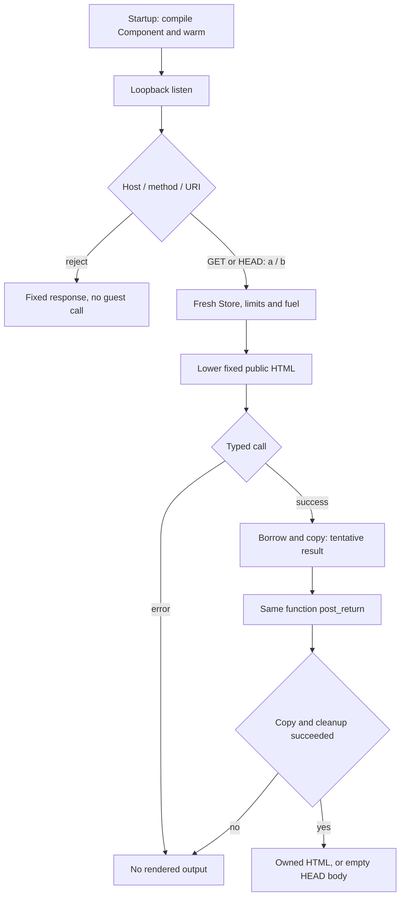

# 要求ごとにStoreを作るComponent実行候補

後続の [selected-page consumer独立実験](selected-wasm-consumer-development.ja.md)は、固定２引数とcopy／post-return後のfreshness gateを調べる別packageである。このHTTP request probeの結果を付け替えず、native７契約とcurrent-A main観測を別々に記録する。

2026-10-29の独立実験。固定Componentの事前生成結果を配信した[先行経路](wasm-publication-example-development.ja.md)とは分け、startupで準備したComponentを要求ごとに実行する候補を調べる。新しい`experiments/wasm-request-probe/`、Cargo.lock、target directoryだけを用い、製品server／DB／WP、root lock、先行実験は変更しない。engine／SDK／WIT worldや本番公開policyの採用ではない。

## startupと要求の分離

EngineとComponentのcompile、固定のwarm callをlistenより前に終える。mainは引数無しでloopbackのOS割当portだけへbindし、準備済みComponentとEngineを要求間で共有する。handlerはcompile、file reread、compiler／PHP／管理ジョブを起動しない。TokioのHTTP接続処理自体を「OS上のtaskが一切増えない」という保証へ読み替えない。

公開用の固定HTML A／Bだけを`/a`／`/b`へ対応させ、GET／HEADごとに新しいStoreを作る。visitorのquery、header、body等をguestやHTMLへ渡さない。HEADも同じ描画を行い、正しいContent-Lengthを残してbodyだけ空にする。固定Host、method、origin-form targetを描画前に検査し、未知target／queryや不正要求をWasm入力へ正規化しない。

## typed inputと後処理

固定UTF-8のhost stringをcanonical reallocでguest memoryへlowerし、guestが返す`WasmStr`をUTF-8検査／byte cap／fallible copyして所有する。成功したcallの`post_return`を必ず完了し、後処理でguest memoryが変わっても所有bytesは元のままであることを確認する。copyやcapの拒否でも後処理を省かず、後処理の失敗を暫定出力に変換しない。

reallocはこの固定UTF-8 call pattern用の単一arenaであり、一般allocator、任意encoding、Rust guest SDKを提供したものではない。入力capはlowerより前、出力capは所有copyより前へ設ける。Storeのmemory／table／instance上限とfuelもinstantiate前に設定する。同じStoreではcounterが進む対照と、要求ごとの新Storeでは1へ戻ることを区別する。

## 所有HTTP観測

READY診断は実PIDとloopback authority、startup compile／warmの観測だけを含む。成功した要求のCALL診断もordinal、固定fixture名、guest counter、byte数だけとし、visitor値や本文をlogへ転記しない。外側checkerはその回の固定Cargo JSONから選んだartifactを所有processとして起動し、HTTP bodyと診断を照合する。新しいstats公開endpointや任意binary／guest／PID／URLの入口は設けない。

通常の製品cache、range、conditional response、TLS、認証、DB、PHP、WASIはこの実験の対象外。fixed profileのno-store／nosniffとGET／HEADの振舞いを、本番policyの確定とは扱わない。fuelはguest実行の制限で、compiler、canonical host側の全allocation、HTTP全体のCPU／wall time／RSSや本番schedulerを一括して保証しない。

現環境のinstalled Rust targetはWindowsとLinuxのみで、新しいguest targetは導入しない。固定Component WATを使う結果を、Rustからguestをbuildした実績、利用者themeの移植成功、native Linuxや三配備環境の成功へ読み替えない。

## 限定結果

Windows nativeのRust 1.96で7 named契約、fmt／all-target Clippyが成功（`target/wasm-request-probe-{tests,fmt,clippy}.log`）。空文字／NUL／Unicode／4096 bytes exact／one-over、同Storeのcounter1→2とfresh1、realloc境界とrealloc／render／postのfuel切れ、拒否時の後処理・error優先を確認した。negative Modeはtest buildだけへ限定している。

外側gateの7契約はmock／localfileでparser、artifact選択、registry／reader／stdout sinkの回収を検査し、Rust／HTTP実行とは分ける。実gateは一度だけ成功し、`target/wasm-request-probe-http-observation.log`／同`.json`に保存した。実PID36740、GET A/B/AとHEAD AはCALL ordinal1～4／各store_counter1／input・output58,77,58,58 bytesに一致し、HEADのnetwork bodyは0だった。間のquery404／Host421／unknown404／POST405／absolute-target400にはCALLが無かった。重複Hostの拒否はnative契約であり、今回の実HTTPには含めない。

READYのcompilations1／warmups1はComponent準備呼出しとwarm描画の回数で、内部の全compiler単位やcanonical helper呼出し数ではない。guest counterとhostのStore作成数も区別する。既設Tokioのcurrent-thread実験で、本番の並列scheduler／負荷性能を証明したものではない。停止前alive、停止後reader終了／EOFとCALL全件、stdout空、一時dir回収を確認。Windowsでのfixture terminateによるexit1は実値として記録し、graceful shutdown成功とはしない。

pair一覧比較と共同の全Python回帰は318実行／312成功／symlink権限6 skip、exit0（`target/wasm-request-and-pair-list-python-suite.log`）、最終11証跡checkerも全exit0（`target/request-pair-list-current-check-summary.json`）。source／lock／checkerとHTTP観測は`target/request-pair-list-checkpoint.json`に記録した。

別の依存観測`target/wasmtime-request-dependency-observation.json`はregistry146＋local1の147 package、146 archive SHAと選択license候補237 fileのarchive／local一致を確認した。候補無し20、MSRV未申告24、checksum JSON不在146件も明示し、法的採用や全source／linked binaryの成分証明とはしない。normal treeのDB／WP／KDF／WASI不在は同checkpointの限定観測。sourceと実験は製品engine／SDKの採用へ接続していない。

再現する固定gateは`python scripts/check_wasm_request_probe.py`。任意guest／binary／PID／URL／port指定を受け付けず、Cargo JSONが返す専用target内のcurrent artifactだけを起動する。Cargo／host／安定した親pathは信頼する前提で、build／diagnosticsのcapture後capをRSS保証へ読み替えない。
